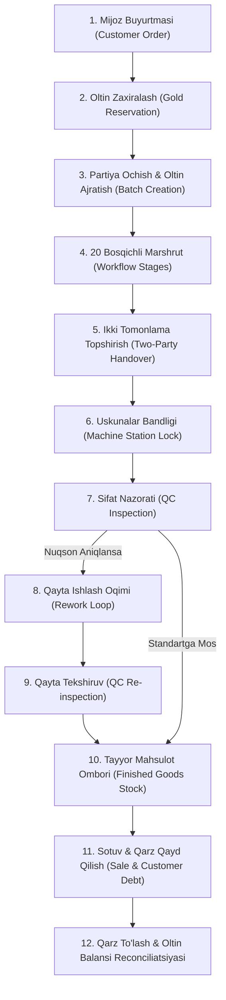

# JEWELRYFLOW ERP — BIZNES VA ISHLAB CHIQARISH WORKFLOW TEST MATRITsASI

**Hujjat Maqsadi:** Barcha biznes va ishlab chiqarish jarayonlarining to'liq zanjirini tekshiruv testlari bilan muvofiqlashtirish.  
**Sana:** 16-oktabr 2026  
**Dvigatel:** Isolated Disposable PGlite (Real PostgreSQL WASM) + Playwright Headless Browser  

---

## 1. YAGONA BIZNES JARAYONI XARITASI (12 BOSQICHLI ZANJIR)

---

## 2. MA'LUMOTLAR BAZASI DARAJASIDAGI TESTLAR MATRITSASI (PHASE A–N: 61 TEST)

| Faza | Testlar | Maqsadi va Tekshiruv Asosi | Kutilgan Natija |
| :--- | :---: | :--- | :--- |
| **Phase A** | Migratsiyalar | 001 dan 025 gacha barcha SQL migratsiyalarni ketma-ket qo'llash | Xatosiz qo'llandi |
| **Phase B** | RLS va Multi-Tenant | Operator B ning Org A partiyalariga ko'rish, o'zgartirish va RPC chaqirishini cheklash | 100% cheklandi, `42501` rad etildi |
| **Phase C** | Oltin Hisobi & Mass Balansi | 585, 750, 999.9 probalar bo'yicha sof oltin ekvivalenti, chiqindi, shlak va me'yordan ortiq yo'qotishlar | Mass balansi $0.0000$g aniqlikda saqlandi, ortiqcha yo'qotishga supervayzer ruxsati talab qilindi |
| **Phase D** | Ikki Tomonlama Topshirish | Dispatched $\rightarrow$ Received oraliq vazn farqi $\pm 0.05$g dan oshganda `DISCREPANCY_FLAGGED` qilish | Supervayzer asosli ruxsat bersagina qabul qilindi |
| **Phase E** | Uskunalar Bandligi | Bir vaqtning o'zida ikkita operator bitta uskunani band qila olmasligi (`IDLE` $\leftrightarrow$ `BUSY`) | Ikkinchi so'rov atomik tarzda rad etildi |
| **Phase F** | Sotuv va Mijoz Qarzi | Tayyor mahsulot sotilganda stok kamayishi, qarz paydo bo'lishi va uni so'ndirish | Salbiy stok va ortiqcha to'lov qat'iy cheklandi |
| **Phase G** | Zavod Sozlamalari | Goldia sozlamalari (`PUMICE`, `ZIRCON` bypass) saqlanishi va boshqa tenant o'zgartira olmasligi | Doimiy bazada saqlanishi tasdiqlandi |
| **Phase H** | QC Nuqson Qaydi | 14-bosqichda nuqson aniqlanganda uni 8-bosqichga (Quyuv) yo'naltirish | WIP to'g'ri qayta taqsimlandi |
| **Phase I** | Kalitlar To'qnashuvi | Org A va Org B bir xil nomli buyurtma va partiyani parallel ochishi | To'qnashuvsiz alohida saqlandi |
| **Phase J** | Qotishma va Affinaj | 585 probadan 750 probaga o'tishda sof oltin massasining saqlanishi | Sof oltin massasi $0.0000$g aniqlikda saqlandi |
| **Phase K** | Ishbay Maosh Nazorati | Topshirish qabul qilinmasdan maosh hisoblanmasligi, takroriy hisoblashdan himoya | Duplikat so'rovlar bekor qilindi |
| **Phase L** | Rework Yakunlanishi | Usta tomonidan nuqsonli buyum tuzatilganda `rpc_complete_qc_rework` orqali qaytarilishi | Rework WIP kamaydi, tekshiruvga qaytdi |
| **Phase M** | Konkurentlik & Idempotentlik | Bir xil `idempotency_key` bilan takroriy so'rovlar keshdan qaytarilishi | Balanslar ikki marta o'zgarmadi |
| **Phase N** | Salbiy va Favqulodda Holatlar | Yetarli oltin bo'lmaganda, manfiy og'irlikda, takroriy partiya ochishda, ruxsatsiz tarozi o'zgartirishda to'siqlar | Barcha 10 ta salbiy holat xavfsiz to'xtatildi |

---

## 3. BRAUZER E2E TESTLAR MATRITSASI (15 TA SSENARIY)

| ID | Test Fayli | Roli | Ssenariy Tavsifi |
| :---: | :--- | :--- | :--- |
| **E2E-01** | `01-auth-navigation.spec.ts` | Anonim | Tizimga kirmagan foydalanuvchini `/login` sahifasiga yo'naltirish |
| **E2E-02** | `01-auth-navigation.spec.ts` | Anonim | Noto'g'ri parol kiritilganda xatolik xabarini ko'rsatish |
| **E2E-03** | `01-auth-navigation.spec.ts` | Director | Goldia Direktori autentifikatsiyasi va sessiya saqlanishi |
| **E2E-04** | `01-auth-navigation.spec.ts` | Director | Barcha asosiy bo'limlar bo'ylab yo'nalishlar navigatsiyasi |
| **E2E-05** | `02-manufacturing-lifecycle.spec.ts` | Director | Oltin seyfidagi qoldiqlar jadvalini ma'lumotlar bazasidan tekshirish |
| **E2E-06** | `02-manufacturing-lifecycle.spec.ts` | Director | Partiya ochish formasi, bosqichlar hosil bo'lishi va QR yorliq chiqishi |
| **E2E-07** | `02-manufacturing-lifecycle.spec.ts` | Director | Ishlab chiqarish markazi (Manufacturing Hub) sexlar paneli |
| **E2E-08** | `02-manufacturing-lifecycle.spec.ts` | Director | Kunlik ishlab chiqarish va oltin reconciliatsiya hisobotlari |
| **E2E-09** | `03-factory-bypass-persistence-isolation.spec.ts` | Director | Goldia profili sozlamalarini (Pumice va Zircon bypass) bazada saqlash |
| **E2E-10** | `03-factory-bypass-persistence-isolation.spec.ts` | Samarkand Dir | Samarkand direktori Goldia partiyalarini ko'ra olmasligini tekshirish |
| **E2E-11** | `04-multi-role-business-journey.spec.ts` | Manager | Ishlab chiqarish menejeri (Bobur Manager) kirishi va marshrut nazorati |
| **E2E-12** | `04-multi-role-business-journey.spec.ts` | Operator | Sex operatori (Davron Usta) kirishi va cheklangan ruxsatlar |
| **E2E-13** | `04-multi-role-business-journey.spec.ts` | QC Inspector | Sifat nazoratchisi (Dilshod QC) kirishi va nuqsonlar paneli |
| **E2E-14** | `04-multi-role-business-journey.spec.ts` | Accountant | Bosh hisobchi (Ziyoda Hisobchi) kirishi, sotuv, qarz va oltin seyfi auditi |
| **E2E-15** | `04-multi-role-business-journey.spec.ts` | Director | Brauzer qayta yuklanganda (page reload) ma'lumotlar bazasi sessiyasi yo'qolmasligi |

---

## 4. XULOSA
Ushbu matrisa JewelryFlow ERP tizimining har bir biznes qadami (buyurtmadan tortib pul va metall reconciliatsiyasigacha) ham ma'lumotlar bazasi darajasida (ACID, RPC, RLS), ham brauzer foydalanuvchi interfeysi darajasida (Playwright) to'liq avtomatlashtirilgan sinovlar bilan qamrab olinganligini tasdiqlaydi.
