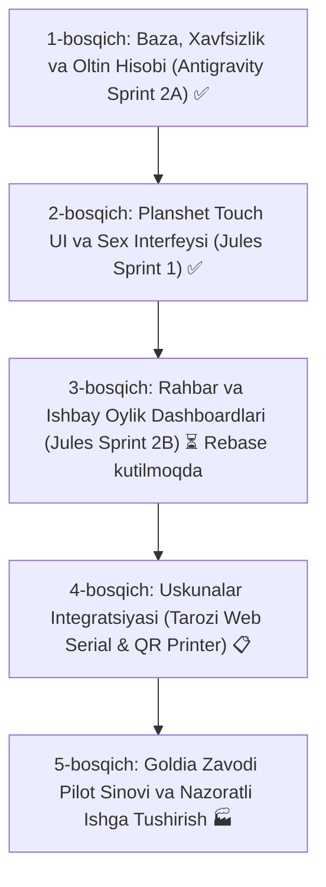

# JEWELRYFLOW ERP — MASTER PLAN & MULTI-AGENT ARCHITECTURE
**Hujjat Nomi:** MASTER_PLAN.md  
**Versiya:** 1.0.0-ORCHESTRATOR-CANONICAL  
**Sana:** 16-oktabr 2026  
**Mualliflik:** Gemini AI Technical Director, Google Antigravity & Jules Lead  

---

## 1. STRATEGIK MAQSAD VA YONDASHUV

JewelryFlow ERP tizimi ikki bosqichli strategik missiyaga ega:

1. **Goldia Factory Core ERP (Birlamchi maqsad — 4–6 haftalik pilot):**
   - O'zbekistondagi real zargarlik ishlab chiqarish zavodi (Goldia) uchun oltin hisobi, xomashyo ombori (Seyf), quyish, mexanik ishlov, kimyoviy ishlov, sifat nazorati (OTM), ishbay oylik va moliya zanjirini 100% raqamlashtirish.
   - 0.05 gramm tolerantlik, ikki tomonlama qabul/topshirish (Two-Party Handover), yo'qotishlar (loss) va chiqindilarni (scrap/sprue/affinaj) hisoblashda 0.0000g aniqlik.
2. **Commercial Multi-Tenant SaaS (Ikkilamchi maqsad):**
   - Turli zargarlik korxonalariga (masalan: Samarkand Gold, Buxoro Zargarlik) alohida obuna orqali xizmat ko'rsatish.
   - Har bir korxona o'zining mustaqil texnologik marshrutiga (masalan: Ponza va Zirkon bosqichlarini yoqish/o'chirish) va dastgoh quvvatlariga ega bo'lishi.
   - Qat'iy PostgreSQL Row Level Security (RLS) orqali korxonalar ma'lumotlari bir-biridan 100% izolyatsiya qilinishi.

---

## 2. MULTI-AGENT ROLLARI VA EGALIK HUQUQI (AGENT ROLES & OWNERSHIP)

| Agent | Boshqaruv / Muhit | Asosiy Mas'uliyat | Ruxsat Etilgan Fayllar (Exclusive Scope) | Taqiqlangan Fayllar (Forbidden Scope) |
|---|---|---|---|---|
| **Google Antigravity** | Lokal Windows muhiti (IDE) | Backend, Database, Core Domain, Security, E2E | `supabase/migrations/*`, `src/lib/*`, `scripts/*`, `src/lib/__tests__/*`, `src/modules/manufacturing/domain/*`, `src/modules/manufacturing/application/*`, `src/modules/manufacturing/infrastructure/*` | `src/components/manufacturing/*`, `src/hooks/manufacturing/*`, `src/app/(dashboard)/manufacturing/*` |
| **Google Jules** | Masofaviy GitHub Coding Agent | Frontend UI, Planshet Touch UI, Dastgoh interfeysi | `src/components/manufacturing/*`, `src/hooks/manufacturing/*`, `src/app/(dashboard)/manufacturing/*`, `src/components/ui/*` | `supabase/migrations/*`, `src/lib/erp-engine.ts`, `src/lib/two-party-handover.ts`, `scripts/*` |
| **JewelryFlow Autopilot (Gemini)** | Markaziy Boshqaruvchi (Orchestrator) | Read-only audit, rejalashtirish, xotira sinxronlash | `memory/*`, `docs/ai/*`, `MASTER_PLAN.md`, `AUTOPILOT_COORDINATION_STATUS.md` | Kod yozuvchi agentlarga tasdiqsiz yozish amallari taqiqlangan (`AUTOPILOT_MODE=READ_ONLY`) |

---

## 3. GIT VA BRANCH XAVFSIZLIK POLITIKASI

1. **`main` Branch (Muzlatilgan / Himoyalangan):**
   - Hech qachon to'g'ridan-to'g'ri push qilinmaydi.
   - Yangi rivojlantirish uchun asos qilib olinmaydi.
   - Avtomatik merge mutlaqo taqiqlanadi.
2. **`dev/manufacturing-erp-saas` (Yagona Faol Development Branch):**
   - Barcha yangi feature branchlar faqat shu branchning oxirgi tasdiqlangan commitidan boshlanadi.
   - Antigravity va Jules integratsiyasi faqat shu branchda amalga oshiriladi.
3. **Feature Branchlar Konvensiyasi:**
   - Antigravity: `feature/ag-<task-id>-<description>`
   - Jules: `feature/jules-<task-id>-<description>`
4. **Qat'iy Qoidalar:**
   - Force push (`git push -f`) — TAQIQLANGAN.
   - Tasdiqsiz push — TAQIQLANGAN.
   - Production Supabase yoki Vercel platformalariga o'zboshimchalik bilan ulanish — TAQIQLANGAN.

---

## 4. MAJBURIY SIFAT VA INTEGRATSIYA DARVOZALARI (QUALITY GATES)

Har qanday kod integratsiya qilinishidan oldin quyidagi barcha sinovlardan o'tishi shart:

1. `npm test` — Barcha Vitest birlik testlari 100% muvaffaqiyatli (0 ta nosozlik).
2. `npm run typecheck` — TypeScript qat'iy tekshiruvida 0 ta xatolik.
3. `npm run lint` — ESLint bo'yicha 0 ta ogohlantirish va 0 ta xatolik.
4. `npm run test:db:all` — Barcha SQL migratsiyalari toza PostgreSQL bazasida qayta takrorlanishi.
5. `npm run test:e2e:browser` — Izolyatsiyalangan staging muhitida Playwright brauzer E2E sinovlari.
6. `npm run build` — Next.js ishlab chiqarish kompilyatsiyasi barcha sahifalarda muvaffaqiyatli bo'lishi.

---

## 5. REJALASHTIRILGAN FAZALAR VA MILESTONELAR

