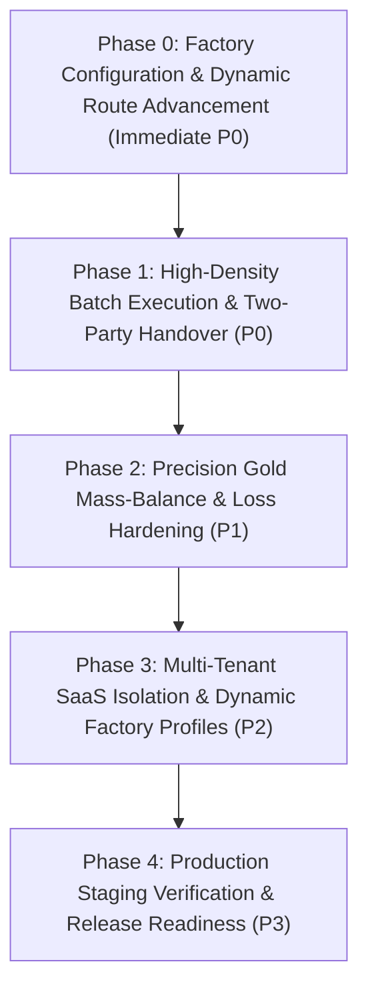

# JewelryFlow ERP — Production & Multi-Tenant SaaS Roadmap

**Lead:** Autonomous Development Lead  
**Branch:** `dev/manufacturing-erp-saas`  
**Target:** Production-grade Jewelry Manufacturing ERP + Multi-tenant SaaS  

---

## Strategic Phases

---

## Detailed Phases

### Phase 0: Factory Configuration & Dynamic Route Advancement (Immediate P0)
- **Objective:** Enable factory-specific workflow configurations without breaking existing generic flows.
- **Key Deliverables:**
  1. Centralized Factory Configuration service (`src/lib/factory-config.ts`) defining active/disabled stage codes per tenant/factory profile.
  2. Factory profile for Goldia:
     - `PUMICE` (Ponza) -> Disabled
     - `ZIRCON` (Zircon machine) -> Disabled
  3. Dynamic stage resolver (`getNextActiveStage`, `getPreviousActiveStage`, `getActiveStages`).
  4. Refactoring `src/app/batches/page.tsx` and related operational views to eliminate hardcoded `fromSt + 1`.
  5. UI Department Navigation & Kanban boards filtered by active stages.
  6. Comprehensive unit test suite covering dynamic routing, skipping, and edge cases.

### Phase 1: High-Density Batch Execution & Two-Party Handover (P0)
- **Objective:** Match the physical factory capacity (30+ workers, 8 laser machines, 2 casting operators, 15-20 models per batch, 10 sets per model).
- **Key Deliverables:**
  1. High-density batch item tracking (multi-model, sets, item quantities).
  2. Partial batch handover mechanism: transfer sub-batches or individual model sets between stages/workers without blocking the entire batch.
  3. Two-party verification protocol: Sender dispatches WIP with measured weight; Receiver confirms receipt with independently measured weight. Discrepancies flagged immediately.
  4. Machine scheduling and queue management for 8 laser stations and 2 casting units.

### Phase 2: Precision Gold Mass-Balance & Loss Hardening (P1)
- **Objective:** Eliminate loss discrepancies across 585, 750, 999 gold purities and chemical recycling.
- **Key Deliverables:**
  1. Stage-level mass balance validation:
     $$\text{Input Weight} = \text{Output Weight} + \text{Scrap / Filings} + \text{Chemical / Dust Loss}$$
  2. Loss tolerance thresholds (per-stage acceptable % variance).
  3. Safe (Seyf) balance reconciliation with double-entry audit logging.
  4. Casting (Quyuv) yield and tree-weight calculation algorithms.

### Phase 3: Multi-Tenant SaaS Architecture & Tenant Isolation (P2)
- **Objective:** Transform the ERP into a SaaS platform where different jewelry factories can define their own stage sequences, machines, and loss tolerances.
- **Key Deliverables:**
  1. `organization_id` abstraction across all operational queries and mutation RPCs.
  2. Dynamic workflow builder: factories can toggle Pumice, Zircon, Enamel, Stone-setting, or Laser stages dynamically.
  3. Tenant-isolated RLS policies in PostgreSQL.
  4. Organization settings management UI for factory directors.

### Phase 4: Production Staging Verification & Release Readiness (P3)
- **Objective:** End-to-end regression validation and automated migration safety.
- **Key Deliverables:**
  1. Non-destructive migration verification scripts.
  2. Automated end-to-end integration tests for multi-model batches.
  3. Final audit report and documentation.
