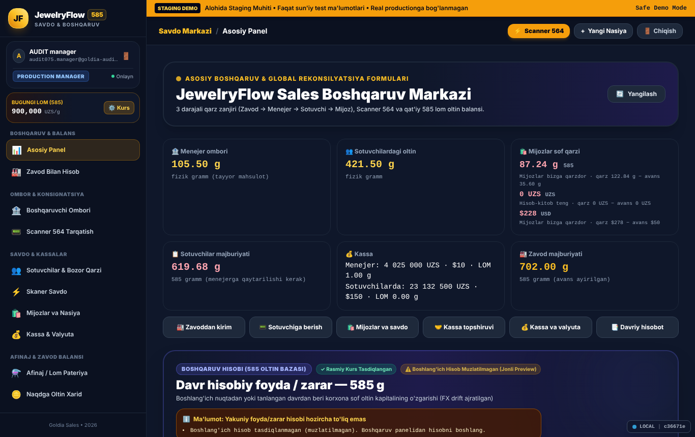

# 01. Goldia Sales — umumiy ko'rinish

> **Tekshiruv pasporti**
> - Tekshirilgan kod: Git commit `052ad17` (branch `claude/goldia-sales-staging-audit-qtrq1d`, 2026-11-19 12:11 UTC).
> - Kodda eng so'nggi schema: migration `20260101000091` (`supabase/migrations/20260101000091_goldia_factory_handover_c2_fix_seller_lom_purchase.sql`).
> - Production holati: **migration 088** — `docs/audits/goldia-077/RELEASE-091-REPORT.md` ("production 088 → 089 → 090 → 091 in one release") va `RELEASE-089-REPORT.md` ("DB 088 → 089") bo'yicha. Production'ga bu sessiyadan ulanilmagan — **to'g'ridan-to'g'ri NOT VERIFIED**.
> - Hujjat sanasi: 2026-11-19. Barcha misollar sintetik.

## 1. Goldia Sales nima?

Goldia Sales — zargarlik (585 proba oltin) savdosini boshqaruvchi veb-ilova. U kattaroq **JewelryFlow ERP** loyihasi ichida joylashgan (`/sales/app/...` yo'llari), ishlab chiqarish (manufacturing) modullaridan alohida ishlaydi. Ilova ichidagi nomi: chap menyu pastida "Goldia Sales • 2026", chap yuqorida logotip "JF", "JewelryFlow" yozuvi, "585" belgisi va "Savdo & Boshqaruv" kichik sarlavhasi (`src/app/sales/app/layout.tsx`).

Asosiy g'oya — **hamma narsa 585 proba oltin grammida hisoblanadi**, pul (so'm, dollar) esa alohida birlik sifatida saqlanadi va faqat aniq kurs bilan grammga aylantiriladi.

## 2. Qarz zanjiri (asosiy biznes modeli)

Ilova bosh sahifasida yozilgan: *"3 darajali qarz zanjiri (Zavod → Menejer → Sotuvchi → Mijoz), Scanner 564 va qat'iy 585 lom oltin balansi"* (`src/app/sales/app/page.tsx`).

```
ZAVOD ──(tovar + zavod foizi)──► MENEJER ──(konsignatsiya + sotuvchi foizi)──► SOTUVCHI ──(savdo + mijoz foizi)──► MIJOZ
  ▲                                 ▲                                            ▲                                   │
  │  oltin topshirish (lom/afinaj)   │  kassa topshiruvi (lom, so'm, $)           │  to'lov (lom, so'm, $)            │
  └─────────────────────────────────┴────────────────────────────────────────────┴───────────────────────────────────┘
```

| Zanjir bo'g'ini | Kim kimga qarzdor | Asosiy jadval / maydon | Manba |
|---|---|---|---|
| 1-zanjir: Zavod ↔ Menejer | Menejer zavodga: kirim × (1 + zavod %) − topshirilgan oltin | `manager_vault_account.current_factory_obligation_g` / `current_factory_advance_g` | `rpc_record_factory_receipt` (070), `_goldia_vault_factory_add` (085) |
| 2-zanjir: Menejer ↔ Sotuvchi ("Bozor qarzi") | Sotuvchi menejerga: konsignatsiya × (1 + sotuvchi %) + eski qarzlar + boshlang'ich majburiyat − topshiruvlar | `seller_gold_accounts.seller_owes_manager_g`, `bozor_qarzi_signed_g` | `recalc_seller_gold_account` (085) |
| 3-zanjir: Sotuvchi ↔ Mijoz ("Nasiya") | Mijoz: savdo vazni × (1 + mijoz %) − to'lovlar (585 g); yoki so'm/dollar summasi | `client_gold_accounts`, `client_currency_accounts` | `rpc_record_weight_sale` (076), `rpc_record_currency_sale` (077) |

## 3. Uch hisob birligi (hech qachon qo'shilmaydi)

`src/lib/customer-balance.ts` boshidagi izoh: *"585 gram, UZS and USD are NEVER added together; each unit has its own totals"*.

1. **585 gramm** (`XAU585`) — asosiy birlik. Boshqa probadagi oltin `fizik g × proba / 585` bilan 585 ekvivalentga keltiriladi.
2. **UZS (so'm)** — naqd pul, valyuta savdolari va valyuta qarzlari.
3. **USD (dollar)** — naqd dollar, dollar narxidagi savdolar va dollar qarzlari.

Kurslar: **LOM (585) kursi** — 1 g 585 oltin necha so'm (`daily_gold_rates`, proba 585); **USD kursi** — 1 $ necha so'm.

## 4. Rollar (qisqacha)

| Rol | Ilovadagi nomi | Imkoniyat |
|---|---|---|
| Direktor | Director / admin / owner / direktor / rahbar | Hamma narsa + moliyaviy qayta boshlash (restart) |
| Menejer (boshqaruvchi) | Production Manager / manager / boshqaruvchi | 077-qarordan beri Goldia Sales'da direktor bilan **bir xil** huquq (restart'dan tashqari) |
| Sotuvchi | Seller / sales / sotuvchi | Faqat 5 sahifa: Asosiy Panel, Skaner Savdo, Mijozlar va Nasiya, Kassam, Ustama Farqi |

Batafsil: `02-roles-permissions.md`.

## 5. Sahifalar xaritasi (menyu)

Menejer/direktor menyusi (`NAVIGATION_GROUPS`, `src/app/sales/app/layout.tsx`):

| Guruh | Sahifa | URL |
|---|---|---|
| BOSHQARUV & BALANS | 📊 Asosiy Panel | `/sales/app` |
| | 🏭 Zavod Bilan Hisob | `/sales/app/factory` |
| OMBOR & KONSIGNATSIYA | 🏦 Boshqaruvchi Ombori | `/sales/app/inventory` |
| | 📟 Scanner 564 Tarqatish | `/sales/app/consignments` |
| SAVDO & KASSALAR | 👥 Sotuvchilar & Bozor Qarzi | `/sales/app/sellers` |
| | 📦 Ombor harakati *(089, deploy qilinmagan)* | `/sales/app/stock-movements` |
| | ⚡ Skaner Savdo | `/sales/app/scan` |
| | 🛍️ Mijozlar va Nasiya | `/sales/app/customers` |
| | 💰 Kassa & Valyuta | `/sales/app/cash` |
| AFINAJ & ZAVOD BALANSI | ⚗️ Afinaj / Lom Pateriya | `/sales/app/refining` |
| | 🪙 Naqdga Oltin Xarid | `/sales/app/purchases` |
| TAHLIL & TIZIM | 🗓️ Davriy Hisobot | `/sales/app/period-report` |
| | 🧾 Boshlang'ich hisob | `/sales/app/opening` |
| | 📑 Moliyaviy Hisobotlar | `/sales/app/reports` |
| | 🏷️ BarTender & Modellar | `/sales/app/models` |
| | 👤 Xodimlar & Telegram | `/sales/app/users` |
| | ⚙️ Sozlamalar & Import | `/sales/app/settings` |

Menyuda yo'q, lekin mavjud sahifalar: `/sales/app/factory-receive` (Zavoddan Tovar Qabul Qilish), `/sales/app/handovers` (Zavodga Oltin Topshirish), `/sales/app/markup`, `/sales/app/kassam` (sotuvchi uchun), `/sales/director`, `/sales/login`, `/sales/mobile` (eski URL, Skaner Savdo'ga yo'naltiradi).

Sotuvchi menyusi (`SELLER_NAVIGATION`, `src/lib/sales-role-access.ts`): 📊 Asosiy Panel, ⚡ Skaner Savdo, 🛍️ Mijozlar va Nasiya, 🏦 Kassam, 📈 Ustama Farqi.

## 6. Hujjat raqamlari (prefikslar)

| Prefiks | Hujjat | RPC |
|---|---|---|
| `ZVD-` | Zavoddan tovar kirimi | `rpc_record_factory_receipt` |
| `CONS-BC-` | Skaner konsignatsiyasi (sotuvchiga tarqatish) | `rpc_issue_barcode_consignment` |
| `SALE-W-` | Vazn bo'yicha savdo (gramm + %) | `rpc_record_weight_sale` |
| `SALE-BC-` | Shtrix-kod (dona) savdo | `rpc_record_barcode_piece_sale` |
| `SALE-UZS-` / `SALE-USD-` | Aniq so'm/dollar narxdagi savdo | `rpc_record_currency_sale` |
| `<sale_no>-V1`, `-V2` | Vozvrat (qaytarish) hujjati | `rpc_record_sale_return` |
| `SETTL-` | Mijozning 585 g qarziga to'lov | `rpc_record_client_settlement` |
| `CPAY-UZS-` / `CPAY-USD-` | Mijozning so'm/dollar qarziga to'lov | `rpc_record_client_currency_settlement` |
| `STL-MGR-` | Sotuvchidan menejerga kassa topshiruvi | `rpc_record_seller_to_manager_settlement` |
| `HND-` | Zavodga oltin topshirish | `rpc_record_factory_gold_handover` |
| `BUY-` | Naqdga oltin xarid | `rpc_record_gold_purchase` |
| `REF-` | Afinaj partiyasi | `rpc_record_refining_batch` |
| `FTX-` | Kapital / xarajat operatsiyasi | `rpc_record_financial_transaction` |
| `OPD-` / `OPN-` | Boshlang'ich hujjat / davr | `rpc_record_opening_document` |

## 7. Production va hali deploy qilinmagan funksiyalar

| Daraja | Holat | Asosiy funksiyalar |
|---|---|---|
| ≤ 088 | **Production'da faol** (hisobotlar bo'yicha) | Savdo (vazn, dona, UZS/USD), SETTL/CPAY to'lovlar, konsignatsiya, kassa topshiruvi, zavod kirimi/topshirish, xarid, afinaj, kapital/xarajat, vozvrat (083), kurslar (084), boshlang'ich hisob/restart (085), freeze (086/087), factory_settled + kurssiz F qarzlar (088) |
| 089 | **Deploy qilinmagan** (release NO-GO bo'lgan) | Eski savdo vozvrati, CPAY jurnalda, to'lov valyutasini tuzatish, kassa sanog'i, Ombor harakati sahifasi |
| 090 | **Deploy qilinmagan** | Konsignatsiyani kirim bo'yicha bekor qilish, menejer → zavodga tovar qaytarish, savdoni tahrirlash, sotuvchi bekor qilish cheklovlari |
| 091 | **Deploy qilinmagan** | Zavodga topshirishda C2 xatosini tuzatish, sotuvchining bozordan LOM xaridi |

Batafsil: `14-releases-and-known-limitations.md`.

## 8. Ko'rinish (skrinshot)



*Izoh: lokal test muhitidagi (077 darajasi, sintetik "AUDIT" foydalanuvchilar) skrinshot. 6 ta karta: Menejer ombori, Sotuvchilardagi oltin, Mijozlar sof qarzi, Sotuvchilar majburiyati, Kassa, Zavod majburiyati; pastda tezkor tugmalar. Yuqoridagi "STAGING DEMO" chizig'i test muhitini bildiradi.*
