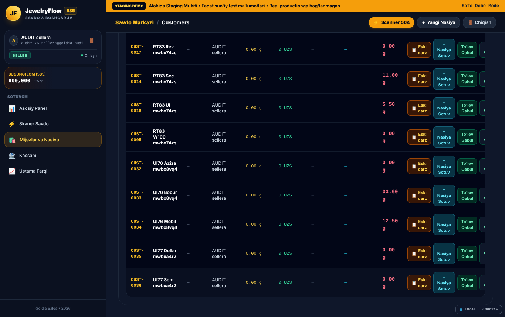
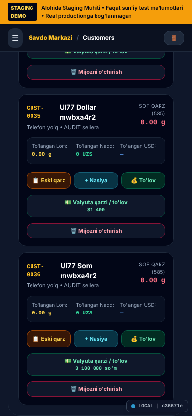

# 03. Savdo (sotuv) jarayonlari

> **Tekshiruv pasporti:** commit `052ad17`, schema `20260101000091` (kod). Production: 088 (release hisobotlari bo'yicha, NOT VERIFIED). Sana: 2026-11-19. Misollar sintetik.

Goldia Sales'da savdoning **4 turi** bor. Hammasi sotuvchining omboridagi (unga tarqatilgan) tayyor 585 mahsulotdan chiqadi.

| # | Turi | Hujjat | RPC (eng so'nggi versiya) | Qarz birligi |
|---|---|---|---|---|
| 1 | Vazn bo'yicha (gramm + %) | `SALE-W-…` | `rpc_record_weight_sale` (076) | 585 g |
| 2 | Shtrix-kod / dona bo'yicha | `SALE-BC-…` | `rpc_record_barcode_piece_sale` (076) | 585 g |
| 3 | Aniq so'm yoki dollar narxda | `SALE-UZS-…`, `SALE-USD-…` | `rpc_record_currency_sale` (077) | UZS yoki USD |
| 4 | Butun partiyani nasiyaga (sotuvchi mobil "Nasiya") | `jewelry_sales` | `rpc_record_client_jewelry_sale` (076) | 585 g |

## 1. Vazn bo'yicha savdo (eng ko'p ishlatiladigan)

**Kim:** sotuvchi (o'z nomidan), menejer, direktor.
**Qayerda:** 🛍️ Mijozlar va Nasiya → mijoz qatorida **"+ Nasiya"** tugmasi → oynada narxlash: **"Gramm + %"**, rejim: **"⚖️ Vazn Bo'yicha (Gramm)"**. (Sotuvchi uchun "⚡ Skaner Savdo" sahifasida ham havola bor: "⚖️ Vazn bo'yicha savdo → Mijozlar".)

**Maydonlar** (`CustomerLedgerAndSheetsSection.tsx`):
- Sotuvchi omboridagi qoldiq (ko'rsatiladi, `get_seller_available_stock_grams`)
- Vazn (g) — majburiy
- "Avtomatik — eng eski donalardan ayriladi" yoki aniq dona tanlash (ixtiyoriy, 076)
- "Mijoz Ustama Foizi (%)" — standart qiymat 12.0 ("Standart: 12.0% yoki 15.0%. Asl bazaviy vazndan mustaqil hisoblanadi.")
- Izoh
- Tugma: **"Nasiyani Rasmiylashtirish"**

**UI tekshiruvlari:** foiz 0–100; vazn > 0; mijozga sotuvchi biriktirilgan bo'lishi ("Mijozga sotuvchi biriktirilmagan. Avval mijozni sotuvchiga biriktiring."); vazn ombordan oshsa tugma o'chadi.

**Server tekshiruvlari** (`rpc_record_weight_sale`):
1. `ERR_MARKUP_REQUIRED` — foiz yuborilmagan; `ERR_MARKUP_OUT_OF_RANGE` — 0..100 dan tashqari.
2. "Sotilayotgan mahsulot vazni 0 dan katta bo'lishi shart".
3. Sotuvchi boshqa sotuvchining mijoziga sota olmaydi (42501).
4. Sotuvchi bo'yicha qulf (`pg_advisory_xact_lock`) — bir vaqtda ikki savdo bir xil grammni ololmaydi.
5. `ERR_INSUFFICIENT_SELLER_STOCK` — sotuvchi omborida yetarli oltin yo'q.
6. Tanlangan donalar uchun: `ERR_PIECE_DUPLICATE`, `ERR_PIECE_NOT_AVAILABLE`, `ERR_PIECES_TOO_LIGHT`, `ERR_PIECE_EXTRA` ("faqat oxirgi dona qisman kesilishi mumkin").
7. Arxivlangan mijoz: `ERR_CUSTOMER_ARCHIVED` (trigger, 079).
8. Idempotentlik: bir xil kalit bilan qayta so'rov birinchi natijani qaytaradi.

**Formula:**
```
mijoz qarzi (client_gold_due) = vazn × (1 + mijoz% / 100)
avansdan ishlatiladi          = min(mijoz avansi, client_gold_due)
yangi qarz                    = client_gold_due − ishlatilgan avans
```
**Misol:** sotuvchida 50 g bor. Mijozga 10 g, 12% bilan: qarz = 10 × 1.12 = **11.2 g**. Mijozda 2 g avans bo'lsa: avans 2 g ishlatiladi, qarz +9.2 g, avans 0.

**Balanslarga ta'siri:**
| Hisob | O'zgarish |
|---|---|
| Sotuvchi ombori (fizik g) | −10 g (donalardan: butun donalar `sold`, oxirgisi kesiladi — `_goldia_consume_weight_sale_pieces`) |
| Mijoz 585 qarzi | +9.2 g (`current_debt_grams`), avans −2 g, `total_purchased_gold_grams` +11.2 |
| Sotuvchi majburiyati (Bozor qarzi) | **o'zgarmaydi** — majburiyat konsignatsiya paytida yaratilgan (085 hisobot: "savdo ombordan oladi, majburiyatni o'zgartirmaydi") |
| Sotuvchi kassasi | o'zgarmaydi (pul hali kelmagan) |
| Zavod hisobi | o'zgarmaydi |

Savdo yozuvida: `factory_markup_pct = 0`, `factory_gold_due_grams = vazn`, `markup_spread_grams = qarz − vazn` (vazn savdosida). Ustama farqi (`markup_difference_g`) trigger orqali yoziladi — `09-dashboard-reports.md`.

**Holat:** qarz ≤ 0.0001 bo'lsa `fully_paid`, aks holda `open_debt`.

## 2. Shtrix-kod (dona) bo'yicha savdo

**Kim:** sotuvchi (faqat o'z nomidan), menejer, direktor.
**Qayerda:** ⚡ Skaner Savdo → "Shtrix-kodli Savdo" (Scanner 564 yoki "Kamera Skaner"); yoki Mijozlar → "+ Nasiya" → "🏷️ Mahsulot Kodi Bo'yicha"; yoki vitrina ro'yxatida "⚡ Sotish".

**Jarayon (sotuvchi mobil):**
1. Model QR kodi va vazn shtrix-kodini skanerlash ("Vazn shtrixkodini skaner qiling (masalan: 14.52)...").
2. Tizim omboringizdan donani topadi: "✅ Omboringizdagi Mahsulot Topildi" (Proba, Aniq Vazn, Model).
3. "Xaridor Mijozni Tanlang *", mijoz foizi (presetlar tugmalari), izoh.
4. "⚡ Savdoni Tasdiqlash va Chek Berish".

**Server tekshiruvlari** (`rpc_record_barcode_piece_sale`): mijoz foizi majburiy (0–100); dona `held_by_seller` holatida, sotilmagan, aynan shu sotuvchiniki bo'lishi; aks holda: "Bu mahsulot donasi (...) allaqachon sotilgan", "Ruxsat etilmadi: Ushbu mahsulot donasi boshqa sotuvchiga biriktirilgan".

**Formula:**
```
zavod qismi (factory_due) = dona vazni × (1 + konsignatsiya zavod% / 100)
mijoz qarzi (client_due)  = dona vazni × (1 + mijoz% / 100)
spread                    = client_due − factory_due
```
**Misol:** dona 5 g, konsignatsiya zavod foizi 8%, mijoz foizi 15%: factory_due = 5.4 g; mijoz qarzi = **5.75 g**; spread = 0.35 g.

**Ta'sir:** dona `sold`; konsignatsiyada `sold_quantity +1` (qolgan donalar 0 bo'lsa `fully_sold`); mijoz qarzi +5.75 g (avans bo'lsa avval avans); sotuvchi majburiyati qayta hisoblanadi (`recalc_seller_gold_account`) — majburiyat o'zgarmaydi, ombor −5 g.

## 3. Aniq so'm / dollar narxdagi savdo (077)

**Qachon:** mahsulot grammda emas, kelishilgan narxda (masalan 2 000 $) sotilsa.
**Qayerda:** Mijozlar → "+ Nasiya" → narxlash **"Aniq UZS"** yoki **"Aniq USD"** (bu rejimda faqat vazn bo'yicha). Maydonlar: vazn (g), narx ("Masalan: 2000" / "Masalan: 25000000"), ixtiyoriy dona, izoh.

**Server** (`rpc_record_currency_sale`): valyuta faqat UZS/USD (`ERR_CURRENCY`); summa > 0 (`ERR_AMOUNT`); vazn > 0; ombor yetarli (`ERR_INSUFFICIENT_SELLER_STOCK`); sotuvchi faqat o'z omboridan; mijozga sotuvchi biriktirilgan bo'lishi kerak ("Sotuvchi aniqlanmadi (mijozga sotuvchi biriktiring yoki sotuvchini tanlang)").

**Ta'sir:**
| Hisob | O'zgarish |
|---|---|
| Sotuvchi ombori | −vazn |
| Mijozning shu valyutadagi qarzi (`client_currency_accounts`) | +summa (shu valyutada avans bo'lsa avval avans ishlatiladi) |
| Mijozning 585 qarzi | **o'zgarmaydi** |
| Sotuvchi majburiyati | o'zgarmaydi (konsignatsiyadan) |
| Savdo yozuvi | `sale_currency`, `sale_amount`, sotuvchining o'sha paytdagi USD va LOM kurslari snapshot (`sale_usd_rate_snapshot`, `sale_lom_rate_snapshot`) |

**Misol (testdan, `goldia-077-...test.ts`):** "$2000 sale of 20 g: stock -20 g, the 22 g obligation stays, customer owes 2000 USD, 585 debt untouched". Ya'ni sotuvchiga 20 g 10% bilan berilgan (majburiyat 22 g) — savdodan keyin ombor −20 g, majburiyat 22 g qoladi, mijoz 2000 $ qarz.

So'm/dollar qarz keyinchalik **CPAY** bilan to'lanadi (`05-payments-currency-lom.md`). Ustama farqi bu savdoda hisoblanmaydi (`markup_difference_g = NULL`).

## 4. Butun partiyani nasiyaga sotish (sotuvchi mobil "🏷️ Nasiya")

**Qayerda:** sotuvchi mobil ish joyi → "Mijozga Nasiyaga Mahsulot Sotish" ("Faqat direktor tasdiqlagan foizlar tanlanadi. Asl vazndan alohida hisoblanadi.") → "Topshiriladigan Mahsulot", "Mijoz", foiz, izoh → "Nasiyani Rasmiylashtirish & Chek".
**RPC:** `rpc_record_client_jewelry_sale`. Faqat **tegilmagan** partiya butunlay sotiladi; aks holda `ERR_CONSIGNMENT_PARTIALLY_USED` ("Partiya ... qisman sotilgan yoki qaytarilgan; donalab yoki vazn bo'yicha sotuvdan foydalaning").
Formula: `qarz = partiya bazaviy vazni × (1 + mijoz%)`; `spread = qarz − partiya factory_gold_due`.

## 5. Savdodan keyin chek

Har savdodan keyin `SalesReceiptModal` ochiladi: "📋 Nusxa olish", "🖨️ Chop etish", "Tayyor (Yopish)". Chekda: hujjat raqami, sotuvchi, mijoz (kod, telefon), mahsulot, bazaviy vazn, foizlar, qarz.

## 6. Savdoni bekor qilish, vozvrat va tahrirlash

Qisqacha (batafsil — `08-returns-reversals.md`):
- **"↩️ Bekor qilish"** (jurnalda) → `rpc_reverse_client_sale` — butun savdo storno; sabab majburiy.
- **"↩️ Vozvrat"** → `rpc_record_sale_return` (083) — qisman yoki to'liq qaytarish, asl savdo o'zgarmaydi.
- **"✏️ Tahrirlash"** → `rpc_edit_client_sale` (**090, deploy qilinmagan**) — eski savdo bekor + to'g'rilangan yangi savdo bitta tranzaksiyada.

## 7. Savdoga oid tez-tez uchraydigan xatolar

| Xabar | Sabab | Yechim |
|---|---|---|
| `ERR_INSUFFICIENT_SELLER_STOCK` | Sotuvchi omborida gramm yetmaydi | Menejer avval tovar tarqatsin (Scanner 564) |
| `ERR_MARKUP_REQUIRED` / `ERR_MARKUP_OUT_OF_RANGE` | Foiz yo'q yoki 0–100 dan tashqari | To'g'ri foiz kiriting |
| "Ushbu mijoz boshqa sotuvchiga biriktirilgan" | Sotuvchi begona mijozga sotmoqchi | Menejer savdo qiladi yoki mijozni qayta biriktiradi |
| `ERR_CUSTOMER_ARCHIVED` | Mijoz arxivda | Avval "♻️ Tiklash" |
| `ERR_PIECE_EXTRA` | Keraksiz qo'shimcha dona tanlangan | Faqat kerakli donalarni tanlang |
| `ERR_OPENING_DRAFT` | Boshlang'ich hisob qoralama holatida — oddiy yozuvlar qulflangan | Boshlang'ich hisob qulflanishini kuting |
| `ERR_FINANCIAL_FREEZE` | Backup/restart uchun moliyaviy yozuvlar to'xtatilgan (086) | Freeze tugashini kuting |

## 8. Skrinshotlar


*Izoh: lokal test (077), "Aniq USD" narxlash rejimi — vazn va dollar narxi kiritiladi, qarz dollarda yoziladi.*


*Izoh: telefon kengligida (390 px) UZS narxdagi savdo oynasi.*
