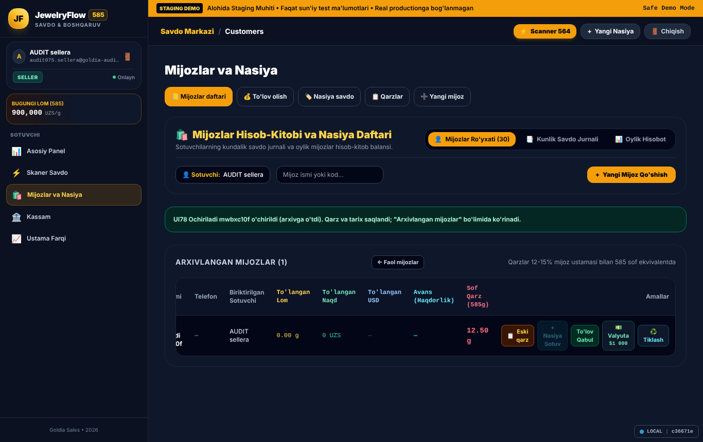

# 04. Mijozlar, nasiya (qarz) va avanslar

> **Tekshiruv pasporti:** commit `052ad17`, schema `20260101000091` (kod). Production: 088 (release hisobotlari bo'yicha, NOT VERIFIED). Sana: 2026-11-19. Misollar sintetik.

## 1. Mijoz balansi modeli

Har mijozning **uchta alohida hisobi** bo'lishi mumkin (`src/lib/customer-balance.ts`):

| Birlik | Jadval | Qarz ustuni | Avans ustuni |
|---|---|---|---|
| 585 gramm | `client_gold_accounts` | `current_debt_grams` | `advance_balance_grams` |
| UZS | `client_currency_accounts` (currency='UZS') | `debt_amount` | `advance_amount` |
| USD | `client_currency_accounts` (currency='USD') | `debt_amount` | `advance_amount` |

Formulalar (har birlik uchun alohida):
```
signedNet   = qarz − avans        (> 0: mijoz bizga qarzdor; < 0: biz mijozga qarzdormiz)
openDebt    = max(0,  signedNet)
openAdvance = max(0, −signedNet)
Jami: grossDebt = Σ openDebt;  grossAdvance = Σ openAdvance;  signedNet = grossDebt − grossAdvance
```
Manfiy jami **"Biz mijozlarga qarzdormiz"** deb ko'rsatiladi, 0 ga qirqilmaydi. **Mijoz avansi sotuvchi majburiyatini o'zgartirmaydi** (customer-balance.ts izohi).

**Misol:** A mijoz: qarz 12 g, avans 0 → +12. B mijoz: qarz 0, avans 3 g → −3. Jami: grossDebt 12, grossAdvance 3, signedNet **+9 g** ("qarz 12 g − avans 3 g"). UZS va USD alohida qatorlarda.

## 2. Avans qanday paydo bo'ladi va qanday ishlatiladi

Avans paydo bo'ladi:
1. To'lov qarzdan ko'p bo'lsa — ortig'i avans (`rpc_record_client_settlement`: "Ortiqcha to'lov (Avans balansi)").
2. Savdo bekor qilinganda mijoz allaqachon to'lagan qism avansga o'tadi (`rpc_reverse_client_sale`, 070 izohi).
3. Vozvrat qiymati ochiq qarzdan oshsa — ortig'i avans, naqd qaytarilmaydi (083).
4. Eski avans kiritilsa (`rpc_record_client_legacy_debt`, balans turi "advance").
5. Boshlang'ich hisobda mijoz avansi (E/F hujjatlar, 085).

Avans ishlatiladi: keyingi savdoda avtomatik — `min(avans, yangi qarz)` (vazn, dona, partiya savdolarida 585 avans; valyuta savdosida shu valyutadagi avans).

## 3. Mijozlar va Nasiya sahifasi (`/sales/app/customers`)

**Komponent:** `CustomerLedgerAndSheetsSection.tsx`. Sarlavha: *"Mijozlar Hisob-Kitobi va Nasiya Daftari"*.

Uch ichki tab:
1. **👤 Mijozlar Ro'yxati (N)** — jadval ustunlari: Kod, Mijoz Ismi, Telefon, Biriktirilgan Sotuvchi, To'langan Lom, To'langan Naqd, To'langan USD, Avans (Haqdorlik), Sof Qarz (585g), Amallar. Yuqorida: "👤 Sotuvchi:" filtri ("Barcha Sotuvchilar (Bozor)"), qidiruv ("Mijoz ismi yoki kod..."), **"+ Yangi Mijoz Qo'shish"**, "🗄️ Arxivlangan mijozlar (N)".
2. **📑 Kunlik Savdo Jurnali** — ustunlar: Sana, Hujjat turi, Klient Ism, Mahsulot / Izoh, Sotilgan gr, Ustama %, gram+%, Lom berdi, Pul berdi (UZS), Lom narxi, Pul+Lom (eq), Qarzdorlik, Amallar. Sana filtri, "Bugun"/"Kecha" tugmalari, CSV.
3. **📊 Oylik Hisobot** — ustunlar: Mijoz Ismi, Kod, Boshlang'ich / Eski Qarz, Oy Davomida Sotuv, Lom Tushumi, Pul Tushumi (UZS), Pul Eq (g), USD Tushumi ($), USD Kursi, USD Eq (g), Jami Yopilgan, Yakuniy Qarz. Pastda: Jami Tarqatilgan (Oyda), Jami Yig'ilgan (Oyda), Mijozlar sof qoldig'i (585), Sotuvchi G'aznasi, Boshqaruvchiga Bozor Qarzi. RPC: `rpc_get_customer_monthly_report` (083).

**Mijoz qatoridagi tugmalar:**
| Tugma | Vazifa | Kim | RPC |
|---|---|---|---|
| 📋 Eski qarz | Eski qarz/avans kiritish yoki qayta solishtirish | hamma (sotuvchi cheklangan) | `rpc_record_client_legacy_debt` |
| ↩️ Eski savdo vozvrati (T0 dan oldingi tovar) | **089, deploy qilinmagan** | management | `rpc_record_opening_sale_return` |
| + Nasiya | Savdo | hamma | `03-sales.md` |
| 💰 To'lov | 585 qarzga to'lov (SETTL) | hamma | `rpc_record_client_settlement` |
| 💵 Valyuta qarzi / to'lov | So'm/USD qarzga to'lov (CPAY) | hamma | `rpc_record_client_currency_settlement` |
| 🗑️ Mijozni o'chirish / ♻️ Tiklash | Arxivlash (soft delete) | sotuvchi o'z mijozini, management hammani | `rpc_archive_customer` |

Jurnal qatoridagi tugmalar: **↩️ Vozvrat** (savdo), **💱 Valyutani tuzatish** (to'lov, management, *089*), **✏️ Tahrirlash** (savdo, *090*), **↩️ Bekor qilish**; tasdiqlangan qatorlarda "🔒 Tasdiqlangan".

## 4. Yangi mijoz

**Maydonlar** (management oynasi): "Mijoz To'liq Ismi *", "Telefon raqami", "Biriktirilgan Sotuvchi", "Izoh / Manzil" → **"Mijozni Saqlash"**.
Sotuvchi mobil: "Ism Familiya (F.I.O)", "Telefon Raqami", "Kompaniya / Pasport yoki PINFL" → "Mijozni Saqlash (ID Yaratish)".
**RPC:** `rpc_create_customer_with_code` (075). Kod tashkilot ichida raqamlanadi (`CUST-0001`...), bir tashkilotda bir xil ism qayta kiritilsa mavjud mijoz qaytariladi (test 075). Sotuvchi mijozni faqat o'ziga biriktiradi. To'g'ridan-to'g'ri INSERT barcha rollar uchun rad etiladi (`_goldia_guard_customer_code`).

## 5. Mijozni arxivlash (o'chirish) — 078/079

- Tugma: "🗑️ Mijozni o'chirish" (arxivda: "♻️ Tiklash").
- **Ochiq qarz saqlanadi**, tarix saqlanadi, qarz hisobotda qoladi va undiriladi (test 078 SEC-3).
- Arxivlangan mijozga yangi savdo qilib bo'lmaydi: *"ERR_CUSTOMER_ARCHIVED: Mijoz arxivlangan (o'chirilgan) - unga yangi savdo qilib bo'lmaydi. Eski qarz to'lovini qabul qilish mumkin; savdo uchun avval mijozni tiklang."*
- Sotuvchi faqat o'z mijozini arxivlaydi/tiklaydi; boshqa holat: "Ruxsat etilmadi: mijozni faqat uning sotuvchisi, menejer yoki direktor arxivlay oladi".
- Qayta bosish hech narsani o'zgartirmaydi (`changed: false`).


*Izoh: lokal test (078) — sotuvchining arxivlangan mijozlar ro'yxati.*

## 6. Eski qarz (legacy debt) — daftardagi qoldiqni kiritish

**Oyna:** "Mijoz Eski Qarzini Kiritish / Qayta Solishtirish". Maydonlar: "Hisoblash usuli" (qayta solishtirish yoki to'g'ridan-to'g'ri), "Balans turi" (Qarz / Avans), miqdor (585 g), "Qaysi sanadagi holat *", "Daftar raqami / Izoh *". Ko'rsatiladi: "Tizimdagi joriy holat", "Daftardagi maqsad", "Kiritiladigan farq (Δ)", "Hosil bo'ladigan yangi qoldiq".

**RPC:** `rpc_record_client_legacy_debt` (081). Yozuv turlari: `initial`, `manual_addition`, `reconciliation_adjustment`, `reversal`, `opening` (085 cheklovi).

**Qayta solishtirish formulasi** (`p_target_final_balance` berilganda):
```
qarz maqsadi:  Δ = maqsad − (joriy qarz − joriy avans)
avans maqsadi: Δ = (−maqsad) − (joriy qarz − joriy avans)
```
**Misol:** mijozda tizimda qarz 8 g, avans 0. Daftarda 10 g bo'lishi kerak → Δ = +2 g, yangi qarz 10 g.

**Qoidalar:**
- Sotuvchi: faqat o'z mijoziga, faqat **qarz qo'shish** (076). Kamaytirish: *"Ruxsat etilmadi: Qarzni kamaytirishni faqat menejer yoki direktor bajaradi"*.
- Sotuvchi avansi (081): faqat qarzi yo'q mijozga va faqat qo'shish sifatida. Qarzi bor mijozga: *"Ruxsat etilmadi: Mijozda ochiq qarz bor (% g) - avans uni kamaytiradi; buni faqat menejer yoki direktor bajaradi"*.
- Bir xil qo'shimcha 10 daqiqa ichida qayta yuborilsa rad: *"Takroriy so'rov: shu mijozga xuddi shu eski qarz (% g) 10 daqiqa ichida kiritilgan."*
- **Sotuvchi majburiyatiga ta'siri:** `balance_type='debt'` bo'lgan eski qarz yozuvlari sotuvchi majburiyatiga qo'shiladi: `seller_legacy_debt_obligation_g = max(0, Σ delta_585_g)` (`recalc_seller_gold_account`). Misol: sotuvchi o'z mijoziga 20 g eski qarz kiritsa, majburiyati ham +20 g (test 076: "his obligation grows 1:1").
- Bekor qilish: faqat management (`rpc_reverse_client_legacy_debt`), sabab majburiy; keyingi qayta solishtirish yozuvi bo'lsa avval o'sha bekor qilinadi.

## 7. Boshlang'ich (T0) qarzlar — E va F hujjatlar (085/088)

- **E** — mijozning 585 g qarzi/avansi; eski qarz yozuvi (`opening` turi) sifatida, sotuvchi majburiyatini 076 qoidasi bo'yicha yaratadi.
- **F** — mijozning so'm/USD qarzi/avansi. Asl valyuta va summa saqlanadi. Kurs berilsa sotuvchi majburiyati **bir marta** yaratiladi: `8 600 000 / 860 000 = 10 g` (USD: summa × USD kursi / 585 kursi). 088'dan kurs ixtiyoriy: kurssiz F "Hali hisoblanmagan" — keyingi har bir to'lov faqat o'sha to'lov kursida va faqat boshlang'ich qarzga tushgan qismini baholaydi.

Batafsil: `05-payments-currency-lom.md` §5 va `07-factory-manager-accounting.md` §7.

## 8. Mijozning birlashtirilgan hisobi

`rpc_get_unified_customer_ledger` (089 versiyasi): har mijoz bo'yicha 585 qarz/avans, valyuta (UZS/USD qarz, avans, CPAY to'langan/soni/bekor qilingan) va `old_sale_return_g`. Production 088'da bu RPC'ning oldingi versiyasi ishlaydi (089 qo'shimchalarisiz).

## 9. Mijoz bo'yicha tez-tez beriladigan savollar

- *"Mijoz qarzi nega manfiy?"* — manfiy = avans: biz mijozga qarzdormiz.
- *"Mijoz o'chirilsa qarz yo'qoladimi?"* — Yo'q, arxivda qarz saqlanadi va to'lov qabul qilinadi.
- *"Sotuvchi mijozni boshqa sotuvchiga o'tkaza oladimi?"* — Yo'q, faqat direktor/menejer (079).
