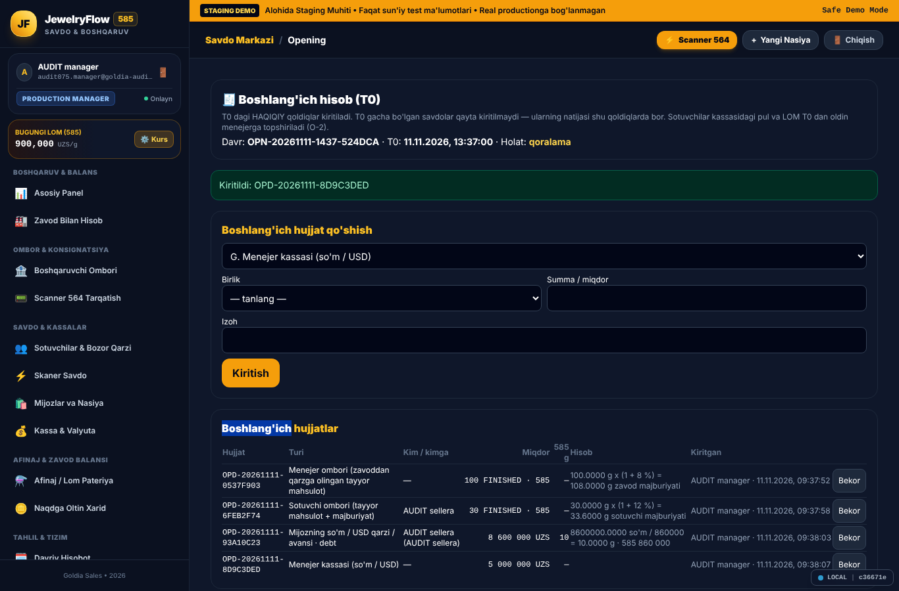

# 07. Zavod bilan hisob, menejer seyfi, xarid, afinaj, kapital va boshlang'ich hisob

> **Tekshiruv pasporti:** commit `052ad17`, schema `20260101000091` (kod). Production: 088 (release hisobotlari bo'yicha, NOT VERIFIED). Sana: 2026-11-19. Misollar sintetik.

## 1. Menejer seyfi (`manager_vault_account`) ustunlari

| Ustun | Ma'nosi | Birlik |
|---|---|---|
| `manager_physical_stock_g` | Menejer omboridagi tayyor mahsulot | fizik g (585) |
| `manager_scrap_grams`, `manager_scrap_585_eq_g`, `manager_scrap_physical_g` | Menejerdagi LOM | 585eq / fizik |
| `manager_refined_gold_grams`, `manager_refined_gold_fine_grams` | Afinajdan chiqqan toza oltin | 585eq / sof |
| `manager_purchased_gold_grams` | Naqdga xarid qilingan oltin | 585eq |
| `manager_capital_pure_gold_g`, `..._fine_g` | Kapital sifatida kiritilgan toza oltin | 585eq / sof |
| `manager_cash_amount`, `manager_usd_amount` | Menejer kassasi | so'm / $ |
| `total_factory_obligation_g`, `total_factory_handed_over_g` | Zavod hisobining jami tomonlari | 585 g |
| `current_factory_obligation_g` / `current_factory_advance_g` | Joriy zavod qarzi / zavoddagi avansimiz | 585 g |

## 2. Zavoddan tovar kirimi

**Kim:** direktor, menejer, buxgalter. **Qayerda:** 🏭 Zavod Bilan Hisob → "📥" bo'limi yoki `/sales/app/factory-receive` ("Zavoddan Tovar Qabul Qilish": *"Zavod partiyasini qabul qilish: 100g 585 mahsulot 8% zavod ustamasi bilan 108g majburiyat hosil qiladi."*).
**Maydonlar:** mahsulot nomi, fizik vazn (standart 100.0000), zavod ustamasi % (standart 8.00), izoh → **"📥 Zavoddan Tovar Qabul Qilish"**.
**RPC:** `rpc_record_factory_receipt` (070) → `ZVD-YYYYMMDD-XXXXXX`.
**Qoidalar:** vazn > 0; proba faqat 585; serverda foiz yuborilmasa 8% (UI har doim qiymat yuboradi).
**Formula:** `zavod majburiyati = fizik × (1 + zavod% / 100)`; `net = jami_majburiyat − jami_topshirilgan`; net ≥ 0 → joriy qarz, aks holda avans.
**Misol:** 100 g, 8% → zavod qarzi +**108 g**; menejer ombori +100 g. Agar oldin zavodda 20 g avansimiz bo'lsa → joriy qarz 88 g.

**Kirimni bekor qilish:** `rpc_reverse_factory_receipt` (058), sabab majburiy; partiyadan tovar tarqatilgan bo'lsa rad ("Avval bog'langan konsignatsiyalarni bekor qiling"). UI'da tarqatilgan kirim "🔒 Tarqatilgan".

## 3. Zavodga oltin topshirish

**Qayerda:** Zavod Bilan Hisob → "Zavodga Oltin Topshirish" (yoki `/sales/app/handovers`). Maydonlar: manba turi, fizik vazn, proba (standart 585), qabul qiluvchi (standart "Zavod"), izoh; manbaga bog'lash (kapital tranzaksiya / afinaj partiyasi / xarid) → **"📤 Zavodga Oltin Topshirish & Qarzni Kamaytirish"**.
**RPC:** `rpc_record_factory_gold_handover` → `HND-YYYYMMDD-XXXXXX`.

| Manba (`source_type`) | Seyfdan ayriladigan ustun | Yetmasa |
|---|---|---|
| `refined_gold` (afinaj) | `manager_refined_gold_grams` (585eq) va sof | `ERR_INSUFFICIENT_VAULT_REFINED` |
| `purchased_gold` (xarid) | `manager_purchased_gold_grams` | `ERR_INSUFFICIENT_VAULT_PURCHASED` |
| `capital_pure_gold` (kapital toza oltin) | `manager_capital_pure_gold_g` | `ERR_INSUFFICIENT_VAULT_CAPITAL_PURE` |
| `scrap_gold` (lom) | `manager_scrap_grams` (fizik vazn bilan tekshiriladi!), fizik va 585eq | `ERR_INSUFFICIENT_VAULT_SCRAP` |
| `finished_goods_return` (090) | — (alohida RPC, §8) | — |

**Formula:** `kelishilgan 585eq = fizik × proba / 585` (UI shu qiymatni yuboradi).
**Misol:** 10 g 999 toza oltin → 585eq = 10 × 999/585 = **17.0769 g**. Zavod qarzi 108 g bo'lsa → 90.9231 g qoladi. Topshirilgan oltin qarzdan ko'p bo'lsa — "Zavod qarzi to'liq yopildi! Zavoddagi avansimiz: ... g".

**Versiya farqi (muhim):**
| | Production (088 kodi) | 091 (deploy qilinmagan) |
|---|---|---|
| Zavod hisobini yangilash | `total_factory_handed_over_g = barcha topshiruvlar yig'indisi` — bu boshlang'ich **C2** (zavodga berilgan avans) va C / tovar qaytarishlarni jami summadan **tushirib yuboradi** (T0 dan keyingi birinchi topshiruvda). | `_goldia_vault_factory_add(org, 0, 585eq)` — hisob aynan topshiruvning 585 ekvivalentiga suriladi. |
| Eski xato hisobni tuzatish | — | Yo'q: *"an account the old code already got wrong stays as it is"*; tekshirish uchun `supabase/release/factory_cards_readonly.sql` (`kartalar_farqi_g`; 0 = to'g'ri, −C2 = xato ta'sir qilgan). |
Manba: `RELEASE-090-REPORT.md` §3, `RELEASE-091-REPORT.md` §1. Sintetik misol (090 hisobotidagi lokal isbot): C2 100 g + bitta 5 g lom topshiruvi → saqlangan "topshirilgan jami" 105 o'rniga **5 g**.

**Bekor qilish:** `rpc_reverse_factory_gold_handover` (091), sabab majburiy; seyf ustuni tiklanadi; 091'da zavod hisobi aynan 585eq qadar orqaga suriladi (0 da jim kesilmaydi). `finished_goods_return` qatorini umumiy bekor qilish rad etiladi: `ERR_FINISHED_GOODS_HANDOVER`.

## 4. Zavod hisobi formulasi va kartalar (088)

```
Haqiqiy zavod hisobi = current_factory_obligation_g − current_factory_advance_g   (> 0: menejer zavodga qarzdor; < 0: zavod menejerga qarzdor)
Kartalar tushuntirishi (src/lib/factory-account-summary.ts):
  tovar qarzi   = Σ faol kirimlar factory_obligation_g − Σ faol factory_settled hujjatlari
  C             = Σ faol "factory_obligation" boshlang'ich hujjatlari (tovarsiz majburiyat)
  berilgan oltin = C2 (faol "factory_advance") + Σ faol topshiruvlar agreed_equivalent_g
  tovar qarzi + C − berilgan oltin  ==  seyf neti   (farq bo'lsa: "⚠️ Kartalar zavod hisobi bilan mos emas: X g farq")
```
Kartalar nomi (UI): "Zavoddan olingan tovar", "Zavod tovari uchun majburiyat (jami) ⓘ", "Zavodga berilgan oltin (jami) ⓘ", "Joriy qoldiq (menejer seyfi bo'yicha) ⓘ". Yo'nalish matni: "Menejerning zavodga qarzi" / "Zavodning menejerga qarzi" / "Zavod bilan hisob yopiq" (`factoryNetWording`).

**Misol:** A kirim 100 g @8% = 108; T0 dagi C2 = 50 g; T0 dan keyin 10 g 999 topshirildi (17.0769). Net = 108 − 50 − 17.0769 = **40.9231 g** (menejer zavodga qarzdor).

## 5. Naqdga oltin xarid ("Tovar Olish")

**Qayerda:** 🪙 Naqdga Oltin Xarid (`/sales/app/purchases`): "Tovar Olish (Naqdga Oltin Xarid Qilish)". Maydonlar: ta'minotchi (standart "Bozor"), sarflangan UZS, sarflangan USD, USD kursi ("Tasdiqlangan: ..." tugmasi), 1 g kursi (ixtiyoriy), oltin vazni, proba (standart 585), izoh → **"💵 Oltin Xaridini Qayd Etish"**.
**RPC:** `rpc_record_gold_purchase` (063) → `BUY-...`. Valyuta: UZS / USD / MIXED.
**Qoidalar:** kamida bitta valyuta > 0; USD bo'lsa USD kursi majburiy; proba 1–1000; seyfda yetarli pul (`ERR_INSUFFICIENT_VAULT_CASH`, `ERR_INSUFFICIENT_VAULT_USD`).
**Formula:** `jami_narx = so'm + dollar × USD_kursi`; `1g_kursi = (kiritilgan yoki) jami_narx / vazn`; `585eq = vazn × proba / 585`.
**Misol:** 5 g 750 oltin, 4 500 000 so'm + 100 $ (kurs 12 600) → jami 5 760 000; 1 g = 1 152 000; 585eq = 6.4103 g. Seyf: so'm −4 500 000, $ −100, xarid oltini +6.4103 g.
**Kompaniya kurs farqi (066):** xarid seyfdagi "qiymatlangan pul havzasi"dan pul sarflasa, trigger `company_rate_differences` ga farq yozadi (`CompanyRateDifferenceCard` — `/sales/director` panelining yuqori qismida: "Kompaniya kurs farqi (naqd → lom xaridi)" — Xarid, Naqd, Qabul kursi, Xarid kursi, Hisob g, Olingan g (585), Farq).
**Bekor qilish:** `rpc_reverse_gold_purchase` (064) — oltin zavodga topshirilgan/ishlatilgan bo'lsa rad.

## 6. Afinaj (lomni eritish, "Lom pateriya")

**Qayerda:** ⚗️ Afinaj / Lom Pateriya. Maydonlar: kirgan lom (g), lom probasi (585), eritilgan vazn, chiqqan toza oltin (g), toza proba (995), izoh → **"🔬 Afinaj Partiyasini Saqlash (Pateriya Qayd Qilish)"**.
**RPC:** `rpc_record_refining_batch` (073) → `REF-...`.
**Formula:**
```
kirish_585eq = lom × lom_proba / 585
chiqish_585eq = toza × toza_proba / 585
yo'qotish (pateriya) = kirish_585eq − chiqish_585eq ;  foiz = yo'qotish / kirish_585eq × 100
```
**Qoidalar:** hammasi > 0; eritilgan ≤ kirgan ("Physical anomaly"); chiqish kirishdan ko'p bo'lmaydi ("Anomalous refining result"); seyfda yetarli lom.
**Misol:** 100 g 585 lom → 58 g 995 toza. Kirish = 100; chiqish = 58 × 995/585 = 98.6496; pateriya = **1.3504 g (1.350%)**. Seyf: lom −100, toza oltin +98.6496 (585eq), sof +58. *"Loss is borne exclusively by manager"* (izoh). Foyda hisobida pateriya baseline'dan keyin alohida ko'rsatiladi.
**Bekor qilish:** `rpc_reverse_refining_batch` — toza oltin yetarli bo'lmasa rad.

## 7. Kapital va xarajatlar

**Qayerda:** Asosiy panel → `ProfitAccountingBanner` → **"💸 Xarajat / Kapital amali"**. Turlar: "Ofis va operatsion xarajat" (`business_expense`), "Ta'sischi hissasi" (`capital_contribution`), "Foyda taqsimoti" (`capital_distribution`). Kapital aktiv turi: so'm, $, lom, toza oltin, tayyor mahsulot; manzil: menejer yoki sotuvchi.
**RPC:** `rpc_record_financial_transaction` (084) → `FTX-...`.
**Formula (585eq):** so'm → `summa / LOM_kursi`; $ → `summa × USD_kursi / LOM_kursi`; lom/585 → `fizik × proba/585`; toza oltin → `fizik × proba/585` (standart proba 995). Pul uchun kurs majburiy (`ERR_RATE_REQUIRED`, `ERR_USD_RATE_NOT_SET`); 084-izoh bo'yicha avvalgi taxminiy standart kurslar (880 000 va 12 800) olib tashlangan.
**Ta'sir:** kapital kirimi — tegishli seyf/kassa ustuniga qo'shiladi (tayyor mahsulot kapitali: zavod qarzisiz "KAPITAL KIRIMI" kirimi); chiqim/xarajat — faqat menejer so'm/$/lom kassasidan (yetmasa rad).
**Qayta tasniflash:** "🔄 Kapitalni qayta tasniflash" — `rpc_reclassify_capital_transaction`. **Bekor qilish:** `rpc_reverse_financial_transaction` (sabab majburiy); tasdiqlangan yozuvni o'chirish taqiqlangan (`ERR_FINANCIAL_TRANSACTION_IMMUTABLE`, trigger `trg_prevent_financial_transaction_mutation`).

## 8. Menejer → zavodga tovar qaytarish — **090, DEPLOY QILINMAGAN**

Zavod sahifasida **"↩️ Menejer omboridan zavodga tovar qaytarish"** (`FactoryGoodsReturnSection`): Zavod kirimi (Tanlang…), Gramm, Sabab → "Zavodga qaytarish"; tarix (Sana, Gramm, Zavod hisobi, Sabab, Holat, "Bekor qilish").
**RPC:** `rpc_return_goods_to_factory` / `rpc_reverse_factory_goods_return`.
**Formula:** `qiymat = gramm × (1 + kirimning o'z zavod%)`; kirim mavjud − gramm; menejer ombori − gramm; zavod neti − qiymat (avans bo'lsa avans o'sadi). Sotuvchi, mijoz, foyda o'zgarmaydi.
**Misol:** 10 g, kirim foizi 8% → zavod qarzi −10.8 g.
**Rad:** ombordagidan ko'p (`ERR_NOT_IN_STOCK`), factory_settled tovar (`ERR_SETTLED_GOODS`), A hujjati foizi kirim foizidan farq (`ERR_PCT_MISMATCH`), sotuvchi.

## 9. Boshlang'ich hisob (T0) va moliyaviy qayta boshlash (085–088)

**Sahifa:** 🧾 Boshlang'ich hisob (`/sales/app/opening`). Sarlavha: *"Boshlang'ich hisob (T0) — T0 dagi HAQIQIY qoldiqlar kiritiladi. T0 gacha bo'lgan savdolar qayta kiritilmaydi... Sotuvchilar kassasidagi pul va LOM T0 dan oldin menejerga topshiriladi (O-2)."*

**Qayta boshlash (faqat direktor)** — "⚠️ Moliyaviy hisobni qayta boshlash": T0, sabab, backup tanlovi va aynan `MOLIYAVIY HISOBNI QAYTA BOSHLASH` matni. Shartlar (085–087): faol **freeze** (086), freeze ichida olingan va tiklab tekshirilgan backup (087), T0 kelajakda emas, 24 soatdan eski emas, freeze'dan 1 soatdan ko'p oldin emas. Hujjatlar o'chirilmaydi — arxivlanadi; barcha qoldiqlar 0; mijozlar, xodimlar, modellar, sozlamalar saqlanadi.

**Boshlang'ich hujjat turlari** (`OpeningAccountingSection.tsx`):
| Tur | Nomi (UI) | Ta'siri |
|---|---|---|
| A | Menejer ombori (zavoddan qarzga olingan tayyor mahsulot) | T0 sanali kirim; 100 g @8% → ombor 100, zavod 108 (foiz standartsiz) |
| B | Sotuvchi ombori (tayyor mahsulot + majburiyat) | 50 g @12% → ombor 50, majburiyat 56 |
| C | Zavodga majburiyat (mahsulotsiz, 585 g) | zavod hisobi + |
| C2 | Zavodga berilgan avans (585 g) | zavod hisobi − |
| D | Sotuvchining qo'shimcha majburiyati (585 g) | majburiyat +, asos majburiy |
| E | Mijozning 585 g qarzi / avansi | eski qarz (`opening`), sotuvchi majburiyati |
| F | Mijozning so'm / USD qarzi / avansi | asl valyuta; kurs bilan bir marta majburiyat (088: kurs ixtiyoriy) |
| G | Menejer kassasi (so'm / USD) | kassa (kapital emas) |
| H | Menejerdagi LOM (proba bilan) | fizik + 585eq |
| I | Menejerdagi toza oltin | 20 g @999 → 34.1538 g (585) va 19.98 g sof |
| J | Boshqa aktiv / majburiyat | foyda va baseline'da alohida |
| factory_settled (088) | B hujjati qatoridagi tugma: "Zavod bilan oldin hisob-kitob qilingan" | faqat zavod hisobini kamaytiradi |

**Solishtirish va qulflash:** 6 tekshiruv (sotuvchi kassasi bo'sh, sotuvchi ombori = donalar, mijoz 585/so'm/USD = hujjatlar, restartdan keyin oddiy hujjat yo'q). Hammasi ✅ bo'lsa "Boshlang'ich hisobni tasdiqlash va qulflash" (USD kursi bilan). Qoralama (draft) davrida barcha oddiy moliyaviy yozuvlar rad: `ERR_OPENING_DRAFT` (12 jadvalda trigger).

**Freeze (086/087):** backup → restart oynasida tashkilotning barcha oddiy moliyaviy yozuvlari rad: `ERR_FINANCIAL_FREEZE`; mijozlar bilan ishlash mumkin; boshqa tashkilot ishlaydi.


*Izoh: lokal test (085) — qoralama davr, hujjat qo'shish formasi (G. Menejer kassasi) va hujjatlar ro'yxati (A: 100 g × 1.08 = 108 g; B: 30 g × 1.12 = 33.6 g; F: 8 600 000 / 860 000 = 10 g).*
