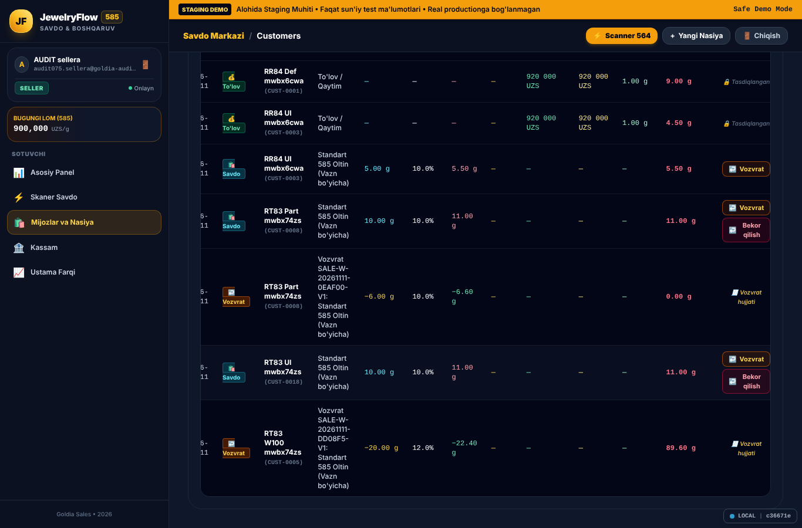

# 08. Bekor qilish (storno), vozvrat (qaytarish) va tahrirlash

> **Tekshiruv pasporti:** commit `052ad17`, schema `20260101000091` (kod). Production: 088 (release hisobotlari bo'yicha, NOT VERIFIED). Sana: 2026-11-19. Misollar sintetik.

**Umumiy qoidalar** (barcha bekor qilish RPC'larida): hujjat o'chirilmaydi — holati `reversed`/`cancelled` bo'ladi va `audit_logs` ga yoziladi; **sabab majburiy**; ikkinchi marta bekor qilish rad ("allaqachon bekor qilingan"); idempotentlik kaliti bilan takror so'rov bir marta bajariladi. UI'da: hujjat ustida "↩️ Bekor qilish" → "Operatsiyani Bekor Qilish (Auditli Kompensatsiya)" oynasi (Hujjat turi, Kvitansiya ID, Mijoz, Sotuvchi, bekor qilinadigan qarz/to'lov, sabab) → **"Tasdiqlash & Bekor Qilish"**.

## 1. Savdoni bekor qilish — `rpc_reverse_client_sale` (077)

**Kim:** management — har qanday savdo; sotuvchi — faqat o'z savdosi. **090 qo'shimcha cheklovi (deploy qilinmagan, trigger `_goldia_guard_seller_sale_cancel`):** sotuvchi faqat o'zi kiritgan (`ERR_NOT_RECORDED_BY_SELLER`), savdodan keyin mijoz to'lov qilmagan (`ERR_SALE_HAS_PAYMENTS`), sana yopilgan davrda emas (`ERR_PERIOD_CLOSED`) savdoni bekor qila oladi; aks holda menejer bekor qiladi.
**Rad:** vozvrat qilingan savdo — `ERR_SALE_HAS_RETURNS` ("butun savdoni bekor qilib bo'lmaydi; qolgan qismini vozvrat qiling", 083).

**Ta'sirlangan barcha hisoblar:**
| Hisob | O'zgarish |
|---|---|
| Savdo hujjati | `status = reversed`, izohga "[BEKOR QILINDI: sabab]" |
| Mijoz 585 hisobi | `net = (qarz − avans) − client_gold_due`; net ≥ 0 → qarz = net; net < 0 → qarz 0, **avans = −net** (to'langan qism yo'qolmaydi, avansga o'tadi) |
| Mijoz valyuta hisobi (UZS/USD savdo) | `net = (qarz − avans) − sale_amount` xuddi shu qoida bilan |
| Donalar | Dona savdosi: dona yana `held_by_seller`; vazn savdosi: `weight_sale_allocations` bo'yicha aniq donalarga qaytariladi (068) |
| Konsignatsiya | `sold_quantity −1`, holat qayta hisoblanadi |
| Sotuvchi ombori | +vazn (sotuv bekor bo'lgani uchun) |
| Sotuvchi majburiyati | o'zgarmaydi (konsignatsiyadan) — `recalc_seller_gold_account` |
| Sotuvchi kassasi | o'zgarmaydi (to'lovlar alohida hujjat) |
| Davriy hisobot | `reversal_sale` qatori bekor qilish sanasida |

**Misol:** savdo 10 g @12% = 11.2 g. Mijoz 4 g to'lagan (qarz 7.2). Bekor: net = 7.2 − 11.2 = −4 → qarz 0, **avans 4 g**; sotuvchi ombori +10 g.

## 2. Vozvrat (qisman/to'liq qaytarish) — `rpc_record_sale_return` (083, production'da)

**Qayerda:** Kunlik Savdo Jurnali → savdo qatorida **"↩️ Vozvrat"** (`SaleReturnModal`). Maydonlar: qaytariladigan vazn, qabul qiluvchi — **"Sotuvchi ombori (sotuvchi javoniga qaytadi)"** yoki **"Menejer qabul qiladi (menejer omboriga)"** (faqat management), sabab. Ogohlantirish: *"Mijoz hisobidan kamayadi: ... Ochiq qarzdan oshgan qismi mijoz foydasiga avans bo'ladi (naqd pul qaytarilmaydi). Asl savdo hujjati o'zgarmaydi."* Tugma: **"Vozvratni tasdiqlash"**. Natija qatori: "🧾 Vozvrat hujjati".

**Qoidalar:** idempotentlik kaliti majburiy; sabab majburiy; vazn ≤ qaytarilmagan qism; dona savdosi faqat butun dona; bekor qilingan savdodan vozvrat yo'q; sotuvchi faqat o'z savdosidan.

**Qiymat formulasi (asl savdo bo'yicha, bugungi kursda emas):**
```
oddiy vozvrat:  qiymat = client_gold_due × qaytgan_vazn / savdo_vazni      (UZS/USD: sale_amount × ulush)
oxirgi (to'ldiruvchi) vozvrat: qiymat = qolgan aniq qoldiq (yaxlitlash qoldig'isiz)
qarz kamayishi = min(qiymat, max(ochiq net, 0));  avans = qiymat − qarz kamayishi
```
**Misol:** savdo 20 g @12% = 22.4 g; mijoz qarzi hozir 5 g. 6 g qaytdi → qiymat = 22.4 × 6/20 = **6.72 g**: qarz −5 g (0), avans +1.72 g. Sotuvchi javoniga 6 g yangi dona (konsignatsiyaga), hujjat `SALE-W-...-V1`.

**Ta'sir:** mijoz hisobi (yuqoridagicha); sotuvchi ombori +6 g; sotuvchi majburiyati **o'zgarmaydi** (konsignatsiyaning `seller_obligation_g` ustuni tegilmaydi; yangi donada `seller_obligation_grams = w × (1 + sotuvchi%)` faqat keyingi qaytarish uchun saqlanadi); "menejer qabul qiladi" tanlansa donalar darhol `rpc_return_piece_to_manager` orqali menejerga o'tadi (majburiyat −, menejer ombori +). Kassa o'zgarmaydi. Asl savdo qatori o'zgarmaydi.


*Izoh: lokal test (083) — "Vozvrat" hujjatlari manfiy gramm bilan ko'rsatiladi (masalan −6.00 g, 10% → −6.60 g); vozvrat qatorida bekor qilish tugmasi yo'q, "Vozvrat hujjati" belgisi bor.*

## 3. Savdoni tahrirlash — `rpc_edit_client_sale` (**090, DEPLOY QILINMAGAN**)

**Qayerda:** jurnal → savdo qatorida **"✏️ Tahrirlash"** (`SaleEditModal`): Vazn (g), Mijoz foizi (%), Mahsulot (dona), Sabab (majburiy).
**Mexanizm:** eski savdo `rpc_reverse_client_sale` bilan bekor qilinadi va **bugungi sana** bilan to'g'rilangan yangi savdo mavjud savdo funksiyasi bilan yoziladi — bitta tranzaksiyada; xato bo'lsa hammasi orqaga qaytadi. `sale_edits` + `audit_logs EDIT_CLIENT_SALE`.
**Nimani tahrirlash mumkin:** vazn savdosi — gramm, %, donalar; dona savdosi — boshqa dona, %; UZS/USD savdo — narx, gramm.
**Rad:** `ERR_SALE_HAS_RETURNS`, `ERR_PERIOD_CLOSED`, `ERR_BEFORE_OPENING_LOCK` (T0 dan oldin), `ERR_SALE_LINKED_PIECE_MOVED`, `ERR_EDIT_NO_CHANGE`, `ERR_REASON_REQUIRED`, `ERR_PIECE_WEIGHT_FIXED`, `ERR_CURRENCY_NO_MARKUP`, `ERR_GRAM_SALE_NO_AMOUNT`, `ERR_SALE_ALREADY_REVERSED` (parallel tahrir); sotuvchi uchun: `ERR_NOT_OWN_SALE` va boshqalar.
**Misol (090 testi):** parallel tahrirda mijoz qarzi aniq 3.6 → 4.2 → 4.8 g.

## 4. To'lovlarni bekor qilish

### 4.1 SETTL — `rpc_reverse_client_settlement` (065), management
| Hisob | O'zgarish |
|---|---|
| Mijoz 585 qarzi | to'lov grammi qarzga qaytadi (avans kamayadi) |
| Sotuvchi kassasi | −lom (fizik, 585eq), −so'm, −dollar |
| Qiymatlangan havza | to'lovning havza ulushi qaytarib olinadi (trigger `trg_goldia_seller_till_pool`) |
| Sotuvchi majburiyati | o'zgarmaydi |
**Rad:** kassada o'sha lom/pul qolmagan (menejerga topshirilgan) — "Avval boshqaruvchiga topshirilgan lomni qaytaring".

### 4.2 CPAY — `rpc_reverse_client_currency_settlement` (088), management
Mijozning valyuta qarzi tiklanadi, kassadan pul/lom chiqadi, havza ulushi va boshlang'ich qarz snapshoti qaytariladi. **Rad:** `ERR_TILL_ALREADY_HANDED_OVER` — *"bu to'lovdan keyin sotuvchi menejerga topshiruv qilgan - avval o'sha topshiruvni bekor qiling, keyin to'lovni, so'ng qayta topshiring"* (088 test M2: "reverse handover -> payment -> hand over again ends exactly (0 g lost)").

### 4.3 Kassa topshiruvi — `rpc_reverse_seller_to_manager_settlement` (073), management
Menejer seyfidan lom/so'm/$ sotuvchi kassasiga qaytadi, havza ulushi qaytadi, sotuvchi majburiyati yana oshadi. **Rad:** seyfda yetarli emas ("Lom allaqachon affinajga yoki zavodga yuborilgan").

### 4.4 Valyutani tuzatish — `rpc_correct_client_payment` (**089, deploy qilinmagan**)
Bekor qilish + qayta yozish bitta amalda (`05-payments-currency-lom.md` §9).

## 5. Konsignatsiya va donalar

| Amal | RPC | Ta'sir |
|---|---|---|
| Donani menejerga qaytarish | `rpc_return_piece_to_manager` | Sotuvchi ombori −w, majburiyat −w×(1+s%), menejer ombori +w |
| Konsignatsiyani bekor qilish | `rpc_reverse_barcode_consignment` | Sotilmagan donalar chiqadi, sotuvchi ombori va majburiyati −, menejer ombori + (production va 090 farqi — `06-inventory-consignment.md` §7) |

**Misol (konsignatsiya reversali):** 15 g (4+5+6), sotuvchi 12% → majburiyat 16.8 g. Hech biri sotilmagan; bekor qilinsa: sotuvchi ombori −15, majburiyat −16.8, menejer ombori +15 (090: aynan qaysi kirimlardan olingan bo'lsa o'shalarga). Bitta dona sotilgan bo'lsa — rad: "% ta mahsulot allaqachon sotilgan ... Avval savdolarni bekor qiling."

## 6. Zavod va seyf hujjatlari

| Hujjat | RPC | Rad etilish sharti | Ta'sir |
|---|---|---|---|
| Zavod kirimi | `rpc_reverse_factory_receipt` | partiyadan tarqatilgan | menejer ombori −, zavod qarzi − |
| Zavodga topshirish | `rpc_reverse_factory_gold_handover` | — | seyf manbasi +, zavod qarzi + |
| Zavodga tovar qaytarish *(090)* | `rpc_reverse_factory_goods_return` | — | kirim/ombor +, zavod qarzi + |
| Oltin xaridi | `rpc_reverse_gold_purchase` | oltin topshirilgan/ishlatilgan | seyf puli +, xarid oltini − |
| Afinaj | `rpc_reverse_refining_batch` | toza oltin yetmaydi | lom +, toza − |
| Kapital/xarajat | `rpc_reverse_financial_transaction` | — | seyf/kassa teskari |
| Eski qarz | `rpc_reverse_client_legacy_debt` | keyingi qayta solishtirish yozuvi bor | mijoz balansi va sotuvchi majburiyati teskari |
| Sotuvchi LOM xaridi *(091)* | `rpc_reverse_seller_lom_purchase` | lom kassada yo'q (`ERR_LOM_ALREADY_USED`) | so'm +, lom − |
| Eski savdo vozvrati *(089)* | `rpc_reverse_opening_sale_return` | qaytgan tovar ishlatilgan (`ERR_RETURN_GOODS_USED`) | mijoz, majburiyat, ombor tiklanadi |

## 7. Eski savdo vozvrati (T0 dan oldin sotilgan tovar) — **089, DEPLOY QILINMAGAN**

**Qayerda:** mijoz qatorida "↩️ Eski savdo vozvrati (T0 dan oldingi tovar)" (management) → `OpeningSaleReturnModal`: "Boshlang'ich qarz", "Qaytgan tovar vazni (g)", "Mijozga sotilgan ASL foiz (%) — majburiy", "Sotuvchi javoniga" / "Menejer omboriga", server oldindan ko'rish ("Qiymat: ... → qarzdan ..., avansga ..."), **"Raqamlarni tekshirdim, tasdiqlayman"** katakchasi, "Sabab".
**Qoidalar:** savdo hujjati yaratilmaydi — mijozning boshlang'ich (E yoki F) qarziga yoziladi; boshlang'ich qarz bo'lmasa `ERR_NO_OPENING_DEBT`. Qiymat: 585 → `gramm × (1 + ASL mijoz%)` (`ERR_PCT_REQUIRED`); UZS/USD → qaytgan tovarning asl summasi (`ERR_AMOUNT_REQUIRED`). Qarz qismi = min(qiymat, ochiq qarz), qolgani avans. Sotuvchi foizi kiritilmaydi (`ERR_SELLER_PCT_NOT_USED`).
**Sotuvchi majburiyati:** tovar sotuvchida qolsa — eski majburiyat o'zgarmasdan qaytgan lotga ko'chadi (jami majburiyat o'zgarmaydi); hujjatsiz qism bo'lsa rad (`ERR_SELLER_KEEP_NOT_DOCUMENTED`); menejerga qaytsa — majburiyat sotuvchidan chiqadi, menejer ombori +.
**Misol (egasining qoidasi, 089 hisobot):** 5 g @20% sotuvchida qoldi: mijoz −6 g, sotuvchi majburiyati 0 o'zgarish ("never -6 + 5.60").
