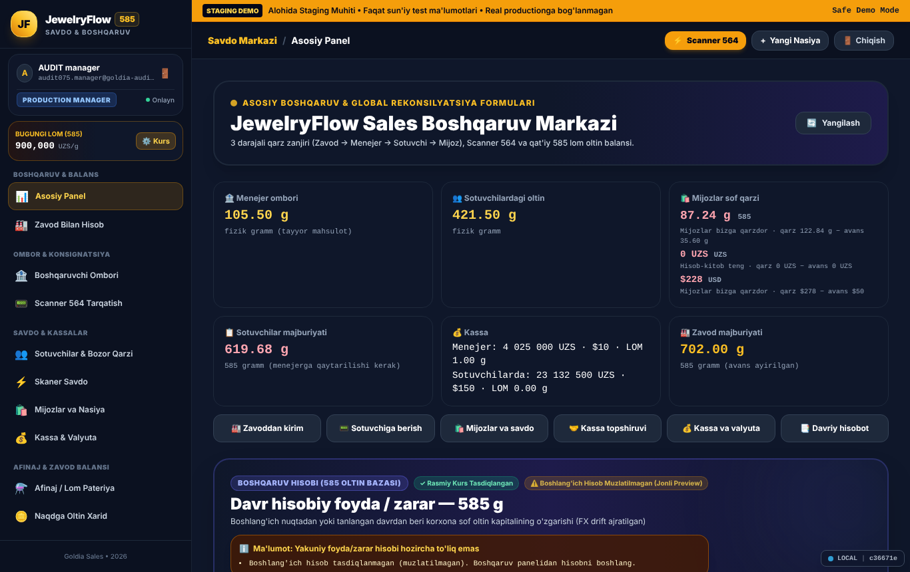
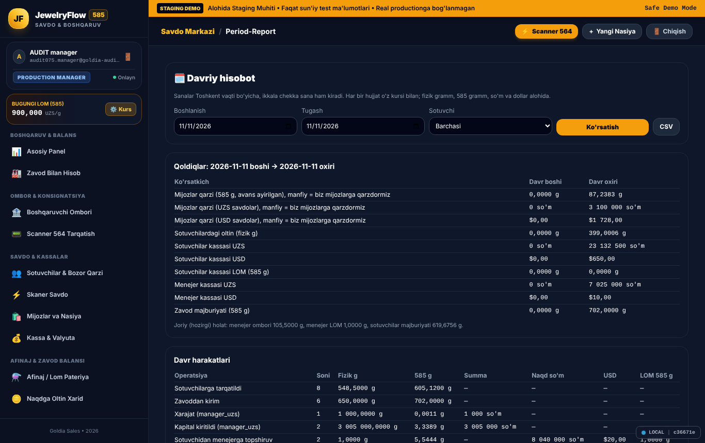

# 09. Asosiy panel, hisobotlar va tahlil

> **Tekshiruv pasporti:** commit `052ad17`, schema `20260101000091` (kod). Production: 088 (release hisobotlari bo'yicha, NOT VERIFIED). Sana: 2026-11-19. Misollar sintetik.

## 1. Asosiy Panel — menejer/direktor (`/sales/app`)

Sarlavha: **"JewelryFlow Sales Boshqaruv Markazi"**, "🔄 Yangilash" tugmasi. Tarkibi (yuqoridan pastga):

### 1.1 Oddiy panel (`ManagerSimplePanel`, 077)
| Karta | Formula (manba ustunlar) |
|---|---|
| 🏦 Menejer ombori — "fizik gramm (tayyor mahsulot)" | `get_manager_available_stock_grams` |
| 👥 Sotuvchilardagi oltin — "fizik gramm" | Σ `seller_gold_accounts.current_physical_stock_g` |
| 🛍️ Mijozlar sof qarzi | 585 / UZS / USD alohida: `signedNet = Σ openDebt − Σ openAdvance` ("qarz X − avans Y"; manfiy = biz qarzdormiz) |
| 📋 Sotuvchilar majburiyati — "585 gramm (menejerga qaytarilishi kerak)" | Σ `seller_owes_manager_g` |
| 💰 Kassa | Menejer: so'm · $ · LOM; Sotuvchilarda: so'm · $ · LOM |
| 🏭 Zavod majburiyati — "585 gramm (avans ayirilgan)" | `current_factory_obligation_g − current_factory_advance_g` |

Tezkor tugmalar: "🏭 Zavoddan kirim" (`/sales/app/factory-receive`), "📟 Sotuvchiga berish" (`/consignments`), "🛍️ Mijozlar va savdo", "🤝 Kassa topshiruvi" (`/sales/app/handovers`), "💰 Kassa va valyuta", "📑 Davriy hisobot". *Diqqat:* "🤝 Kassa topshiruvi" tugmasi "Zavodga Oltin Topshirish" sahifasiga olib boradi — `CONFLICTS.md` C-07.

**Misol:** menejer ombori 105.5 g; sotuvchilarda 421.5 g; mijozlar: qarz 122.84 g − avans 35.6 g = **87.24 g**; sotuvchilar majburiyati 619.68 g; zavod 702 g. (Skrinshotdagi sintetik raqamlar.)

### 1.2 Foyda/zarar banneri (`ProfitAccountingBanner`)
Sarlavha: "Davr hisobiy foyda / zarar — 585 g". Tugmalar: "🔍 Tarkibini ko'rish", "💸 Xarajat / Kapital amali", "🔄 Kapitalni qayta tasniflash", "🎯 Hisobni boshlash" (baseline). RPC: `rpc_get_accounting_profit_summary` (085). Formula — §5.

### 1.3 "Batafsil: rekonsilyatsiya, texnik ko'rsatkichlar va sotuvchilar jadvali" (yig'ma bo'lim)
6 ta karta: 1. Zavod Majburiyati, 2. Ombor & Sotuvchidagi Tovar, 3. Mijozlar Sof Nasiyasi, 4. Sotuvchilar Kassasi, 5. Menejer Seyfi, 6. Afinaj Oltin (585 Eq). Keyin "Fizik Tovar Balansi" (`06-inventory-consignment.md` §1), 3 darajali qarz (1-Daraja: Zavod Majburiyati, 2-Daraja: Sotuvchilar Mas'uliyati, 3-Daraja: Mijozlar Nasiyasi), "🏦 Likvid G'azna", sotuvchilar jadvali (Sotuvchi, Topshirilgan Majburiyat, Kassadagi Lom, Kassadagi Naqd Pul, Bozor Qarzi, Amal).



## 2. Sotuvchi paneli (`SellerDashboard`)

"Sotuvchi paneli" kartalari: **Mening bozor qarzim (585)**, **Mijozlarimning jami qarzi** ("Mijozlar ro'yxati →"), **Mening tovarim (sotilmagan)**, **Mening kassam (topshirilmagan)** (Lom, Naqd, Dollar), **Mening ustama farqim** ("Sotilgan ustama − tayinlangan ustama"), **Bugungi savdolarim** (Savdo, To'lov soni), **Bugungi kurslarim** (LOM, USD, "Kursni o'zgartirish →"). Tugmalar: "⚡ Skaner savdo", "➕ Yangi mijoz", "💰 To'lov olish", "🏷️ Nasiya savdo". Pastda "Oxirgi amallarim (30 kun)".

## 3. Sotuvchilar & Bozor Qarzi (`/sales/app/sellers`)

P0 (2026-11-18, `28cf104`): avval sotuvchi kartalari — **majburiyat, ombor, LOM, UZS, USD, qabul tugmasi**; pastda yig'ma bo'limlar "Sotuvchilar kurslari" va "Operatsiya kurslari tekshiruvi". (Production UI'da bu tartib borligi — NOT VERIFIED; `14-releases...` ga qarang.)
Karta formulasi (`seller-card-metrics.ts`): `bozor_qarzi_signed_g = manager_owes_seller_g − seller_owes_manager_g` → manfiy: sotuvchi qarzdor; musbat: menejer qarzdor.
Har kartada: kassani qabul qilish (topshiruv, `05` §5), "🧮 Kassa sanog'i" (*089*), sotuvchi solishtirma hisoboti (`SellerReconciliationModal`, `rpc_get_seller_reconciliation_statement`).

**Bozor qarzi formulasi** (`recalc_seller_gold_account`, 085):
```
jami majburiyat = Σ konsignatsiya seller_obligation_g (yo'q bo'lsa factory_gold_due)  [held/partially/fully_sold]
                + max(0, Σ eski qarz delta (debt, bekor qilinmagan))
                + boshlang'ich majburiyat (D, E, F snapshotlari)
topshirilgan    = Σ bekor qilinmagan topshiruvlar total_settled_grams
seller_owes  = max(0, majburiyat − topshirilgan);  manager_owes = max(0, topshirilgan − majburiyat)
```
**Misol:** konsignatsiya 16.8 g + eski qarz 5 g = 21.8 g; topshiruvlar 20 g → sotuvchi qarzi **1.8 g** (Bozor qarzi −1.8).

## 4. Davriy hisobot (`/sales/app/period-report`, 077/080)

Matn: *"Sanalar Toshkent vaqti bo'yicha, ikkala chekka sana ham kiradi. Har bir hujjat o'z kursi bilan; fizik gramm, 585 gramm, so'm va dollar alohida."* Filtr: Boshlanish, Tugash, Sotuvchi → "Ko'rsatish", "CSV".
Bo'limlar:
1. **Ko'rsatkich / Davr boshi / Davr oxiri** (qoldiqlar; manfiy mijoz qoldig'i "Biz mijozlarga qarzdormiz").
2. **Davr harakatlari:** Operatsiya, Soni, Fizik g, 585 g, Summa, Naqd so'm, USD, LOM 585 g. Operatsiya nomlari (`KIND_LABEL`): "Zavoddan kirim", "Sotuvchilarga tarqatildi", "Sotuvchilardan qaytdi", "Savdo: gramm + %", "Savdo: aniq UZS narxda", "Savdo: aniq USD narxda", "Savdo bekor qilindi / qaytarildi", "Vozvrat (585 savdodan, qisman / to'liq)", "To'lov: 585 qarzga (naqd / USD / lom)", "To'lov: UZS qarzga", "To'lov: USD qarzga", "Sotuvchidan menejerga topshiruv", "Zavodga topshirildi", "Naqdga oltin xarid", "Kapital qayta tasniflandi", "Eski qarz yozuvi bekor qilindi", 089/091 qo'shimchalari ("Eski savdodan vozvrat ...", "Sotuvchi bozordan LOM xaridi (kassa ichida UZS → lom)").
3. **Sotuvchilar kesimida:** Sotuvchi, Gramm savdo, UZS savdo, USD savdo, Olgan / qaytargan, Kassa (oxiri), Majburiyat (hozir).
4. **Hisobot davrlari:** **"Yangi davrni boshlash (X gacha yopish)"** — *"faqat tanlangan tugash sanasigacha bo'lgan davrni yopib, hisobot nusxasini saqlaydi. Mijoz qarzi, sotuvchi majburiyati, oltin va kassa NOLGA TUSHIRILMAYDI, hech qanday tranzaksiya o'chirilmaydi."* Ro'yxatda "Ko'rish", "Qayta ochish" (faqat oxirgi davr, 078).

**Invariant (test 077 C):** *"opening + flows = closing, nothing undocumented, closing a period changes nothing"*. Manba: `_goldia_period_effects` (091 versiyasi; production'da 088 versiyasi).


*Izoh: lokal test (077) — qoldiqlar va davr harakatlari jadvali.*

## 5. Foyda formulasi (`rpc_get_accounting_profit_summary`, 085)

```
AKTIVLAR (585 g) = menejer ombori + sotuvchilar ombori + menejer lom + sotuvchilar lom
                 + afinaj oltini + kapital toza oltin + xarid oltini + afinajdagi WIP
                 + mijozlar 585 qarzi + (jami so'm / LOM kursi) + (jami $ × USD kursi / LOM kursi)
                 + mijozlar UZS/USD qarzi (585eq) + zavoddagi avansimiz + boshqa boshlang'ich aktivlar
MAJBURIYATLAR    = zavod qarzi + mijozlar 585 avansi + mijozlar UZS/USD avansi (585eq) + boshqa majburiyatlar
SOF AKTIV        = AKTIVLAR − MAJBURIYATLAR
Zavod neti       = Σ kirim factory_obligation − Σ topshiruv agreed_eq + boshlang'ich zavod neti (C − C2 − factory_settled)
DAVR NATIJASI    = (joriy sof aktiv − baseline sof aktiv) − kapital kirimi + kapital chiqimi − baseline'dan keyingi eski qarz deltalari
```
Xarajatlar sof aktivni allaqachon kamaytirgani uchun qayta qo'shilmaydi (070). Kurs yo'q bo'lsa natija hisoblanmaydi: holat `not_valued` ("UZS baholanmadi (585 kursi yo'q)..."), baseline yo'q bo'lsa `baseline_not_set`.

**Misol:** baseline sof aktiv 1 000 g. Hozir 1 080 g. Davrda kapital kirimi 30 g, foyda taqsimoti 10 g, eski qarz deltasi +5 g. Natija = (1080 − 1000) − 30 + 10 − 5 = **55 g**.

## 6. Ustama farqi (067) — `/sales/app/markup` va menejer hisobotida

`MarkupDifferenceCard` ("📈 Ustama farqi"; sotuvchida `/sales/app/markup`, menejerda `/sales/director` bannerida sotuvchilar kesimi bilan): Dan, Gacha, sotuvchi filtri; jamlar: Musbat, Manfiy, "Amalga oshgan", "Hali to'lanmagan"; jadval: Sana, Savdo, Mijoz, Model, Vazn, Tayinlangan, Haqiqiy, Farq. RPC `rpc_get_seller_markup_difference_report` (sotuvchiga faqat o'z savdolari).
```
farq_g = asl vazn × (mijoz% − tayinlangan sotuvchi%) / 100
```
**Misol (migration 067 izohi):** 100 g, tayinlangan 15%, sotilgan 12% → **−3 g**; 20% → **+5 g**; jami +2 g. Farq **kompaniyaniki** (Goldia), sotuvchi majburiyati/mijoz qarzi/kassaga ta'sir qilmaydi; mijoz to'lagan ulush bo'yicha "amalga oshgan" hisoblanadi. UZS/USD savdoda farq yo'q (NULL).

## 7. Kompaniya kurs farqi (066/085)

- **Xarid:** naqd pul havzasidan oltin xarid qilinganda (`CompanyRateDifferenceCard`, `/sales/director` yuqori bannerida; menejer menyusidagi sahifalarda ko'rinmaydi).
- **Topshiruv (085, D-2):** `company_rate_difference_585_g = qiymatlangan_g − qiymatlangan_pul / topshiruv kursi` (musbat = kompaniyaga xarajat). Foyda xulosasida baseline'dan beri yig'indi alohida ko'rsatiladi.

## 8. Moliyaviy Hisobotlar (`/sales/app/reports`)

"Moliyaviy Hisobotlar & Rekonsilyatsiya Tarixi" → "Oxirgi Tushum va Qaytimlar Arxivi" (to'lovlar, topshiruvlar; bekor qilish tugmasi). Menyuda `Accountant` roli uchun ham ochiq (UI ro'yxati).

## 9. Mijozlar oylik hisoboti

`04-customer-debts.md` §3 (Oylik Hisobot tab, `rpc_get_customer_monthly_report`).
