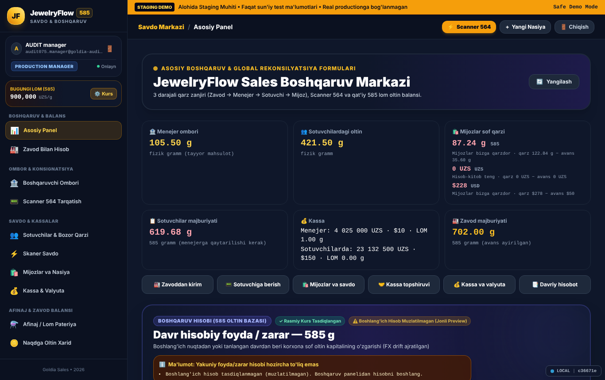

# Goldia Sales — 1-to'plam: Umumiy ko'rinish, rollar, qo'llanma, lug'at
> Ushbu to'plam quyidagi fayllarni birlashtiradi: 01-overview.md, 02-roles-permissions.md, 10-complete-user-manual.md, 15-glossary.md. Tekshirilgan kod: commit `052ad17`, schema `20260101000091`; production 088 (NOT VERIFIED). Sana: 2026-11-19. Barcha misollar sintetik.


---

<!-- manba fayl: 01-overview.md -->

## 01. Goldia Sales — umumiy ko'rinish

> **Tekshiruv pasporti**
> - Tekshirilgan kod: Git commit `052ad17` (branch `claude/goldia-sales-staging-audit-qtrq1d`, 2026-11-19 12:11 UTC).
> - Kodda eng so'nggi schema: migration `20260101000091` (`supabase/migrations/20260101000091_goldia_factory_handover_c2_fix_seller_lom_purchase.sql`).
> - Production holati: **migration 088** — `docs/audits/goldia-077/RELEASE-091-REPORT.md` ("production 088 → 089 → 090 → 091 in one release") va `RELEASE-089-REPORT.md` ("DB 088 → 089") bo'yicha. Production'ga bu sessiyadan ulanilmagan — **to'g'ridan-to'g'ri NOT VERIFIED**.
> - Hujjat sanasi: 2026-11-19. Barcha misollar sintetik.

### 1. Goldia Sales nima?

Goldia Sales — zargarlik (585 proba oltin) savdosini boshqaruvchi veb-ilova. U kattaroq **JewelryFlow ERP** loyihasi ichida joylashgan (`/sales/app/...` yo'llari), ishlab chiqarish (manufacturing) modullaridan alohida ishlaydi. Ilova ichidagi nomi: chap menyu pastida "Goldia Sales • 2026", chap yuqorida logotip "JF", "JewelryFlow" yozuvi, "585" belgisi va "Savdo & Boshqaruv" kichik sarlavhasi (`src/app/sales/app/layout.tsx`).

Asosiy g'oya — **hamma narsa 585 proba oltin grammida hisoblanadi**, pul (so'm, dollar) esa alohida birlik sifatida saqlanadi va faqat aniq kurs bilan grammga aylantiriladi.

### 2. Qarz zanjiri (asosiy biznes modeli)

Ilova bosh sahifasida yozilgan: *"3 darajali qarz zanjiri (Zavod → Menejer → Sotuvchi → Mijoz), Scanner 564 va qat'iy 585 lom oltin balansi"* (`src/app/sales/app/page.tsx`).

```
ZAVOD ──(tovar + zavod foizi)──► MENEJER ──(konsignatsiya + sotuvchi foizi)──► SOTUVCHI ──(savdo + mijoz foizi)──► MIJOZ
  ▲                                 ▲                                            ▲                                   │
  │  oltin topshirish (lom/afinaj)   │  kassa topshiruvi (lom, so'm, $)           │  to'lov (lom, so'm, $)            │
  └─────────────────────────────────┴────────────────────────────────────────────┴───────────────────────────────────┘
```

| Zanjir bo'g'ini | Kim kimga qarzdor | Asosiy jadval / maydon | Manba |
|---|---|---|---|
| 1-zanjir: Zavod ↔ Menejer | Menejer zavodga: kirim × (1 + zavod %) − topshirilgan oltin | `manager_vault_account.current_factory_obligation_g` / `current_factory_advance_g` | `rpc_record_factory_receipt` (070), `_goldia_vault_factory_add` (085) |
| 2-zanjir: Menejer ↔ Sotuvchi ("Bozor qarzi") | Sotuvchi menejerga: konsignatsiya × (1 + sotuvchi %) + eski qarzlar + boshlang'ich majburiyat − topshiruvlar | `seller_gold_accounts.seller_owes_manager_g`, `bozor_qarzi_signed_g` | `recalc_seller_gold_account` (085) |
| 3-zanjir: Sotuvchi ↔ Mijoz ("Nasiya") | Mijoz: savdo vazni × (1 + mijoz %) − to'lovlar (585 g); yoki so'm/dollar summasi | `client_gold_accounts`, `client_currency_accounts` | `rpc_record_weight_sale` (076), `rpc_record_currency_sale` (077) |

### 3. Uch hisob birligi (hech qachon qo'shilmaydi)

`src/lib/customer-balance.ts` boshidagi izoh: *"585 gram, UZS and USD are NEVER added together; each unit has its own totals"*.

1. **585 gramm** (`XAU585`) — asosiy birlik. Boshqa probadagi oltin `fizik g × proba / 585` bilan 585 ekvivalentga keltiriladi.
2. **UZS (so'm)** — naqd pul, valyuta savdolari va valyuta qarzlari.
3. **USD (dollar)** — naqd dollar, dollar narxidagi savdolar va dollar qarzlari.

Kurslar: **LOM (585) kursi** — 1 g 585 oltin necha so'm (`daily_gold_rates`, proba 585); **USD kursi** — 1 $ necha so'm.

### 4. Rollar (qisqacha)

| Rol | Ilovadagi nomi | Imkoniyat |
|---|---|---|
| Direktor | Director / admin / owner / direktor / rahbar | Hamma narsa + moliyaviy qayta boshlash (restart) |
| Menejer (boshqaruvchi) | Production Manager / manager / boshqaruvchi | 077-qarordan beri Goldia Sales'da direktor bilan **bir xil** huquq (restart'dan tashqari) |
| Sotuvchi | Seller / sales / sotuvchi | Faqat 5 sahifa: Asosiy Panel, Skaner Savdo, Mijozlar va Nasiya, Kassam, Ustama Farqi |

Batafsil: `02-roles-permissions.md`.

### 5. Sahifalar xaritasi (menyu)

Menejer/direktor menyusi (`NAVIGATION_GROUPS`, `src/app/sales/app/layout.tsx`):

| Guruh | Sahifa | URL |
|---|---|---|
| BOSHQARUV & BALANS | 📊 Asosiy Panel | `/sales/app` |
| | 🏭 Zavod Bilan Hisob | `/sales/app/factory` |
| OMBOR & KONSIGNATSIYA | 🏦 Boshqaruvchi Ombori | `/sales/app/inventory` |
| | 📟 Scanner 564 Tarqatish | `/sales/app/consignments` |
| SAVDO & KASSALAR | 👥 Sotuvchilar & Bozor Qarzi | `/sales/app/sellers` |
| | 📦 Ombor harakati *(089, deploy qilinmagan)* | `/sales/app/stock-movements` |
| | ⚡ Skaner Savdo | `/sales/app/scan` |
| | 🛍️ Mijozlar va Nasiya | `/sales/app/customers` |
| | 💰 Kassa & Valyuta | `/sales/app/cash` |
| AFINAJ & ZAVOD BALANSI | ⚗️ Afinaj / Lom Pateriya | `/sales/app/refining` |
| | 🪙 Naqdga Oltin Xarid | `/sales/app/purchases` |
| TAHLIL & TIZIM | 🗓️ Davriy Hisobot | `/sales/app/period-report` |
| | 🧾 Boshlang'ich hisob | `/sales/app/opening` |
| | 📑 Moliyaviy Hisobotlar | `/sales/app/reports` |
| | 🏷️ BarTender & Modellar | `/sales/app/models` |
| | 👤 Xodimlar & Telegram | `/sales/app/users` |
| | ⚙️ Sozlamalar & Import | `/sales/app/settings` |

Menyuda yo'q, lekin mavjud sahifalar: `/sales/app/factory-receive` (Zavoddan Tovar Qabul Qilish), `/sales/app/handovers` (Zavodga Oltin Topshirish), `/sales/app/markup`, `/sales/app/kassam` (sotuvchi uchun), `/sales/director`, `/sales/login`, `/sales/mobile` (eski URL, Skaner Savdo'ga yo'naltiradi).

Sotuvchi menyusi (`SELLER_NAVIGATION`, `src/lib/sales-role-access.ts`): 📊 Asosiy Panel, ⚡ Skaner Savdo, 🛍️ Mijozlar va Nasiya, 🏦 Kassam, 📈 Ustama Farqi.

### 6. Hujjat raqamlari (prefikslar)

| Prefiks | Hujjat | RPC |
|---|---|---|
| `ZVD-` | Zavoddan tovar kirimi | `rpc_record_factory_receipt` |
| `CONS-BC-` | Skaner konsignatsiyasi (sotuvchiga tarqatish) | `rpc_issue_barcode_consignment` |
| `SALE-W-` | Vazn bo'yicha savdo (gramm + %) | `rpc_record_weight_sale` |
| `SALE-BC-` | Shtrix-kod (dona) savdo | `rpc_record_barcode_piece_sale` |
| `SALE-UZS-` / `SALE-USD-` | Aniq so'm/dollar narxdagi savdo | `rpc_record_currency_sale` |
| `<sale_no>-V1`, `-V2` | Vozvrat (qaytarish) hujjati | `rpc_record_sale_return` |
| `SETTL-` | Mijozning 585 g qarziga to'lov | `rpc_record_client_settlement` |
| `CPAY-UZS-` / `CPAY-USD-` | Mijozning so'm/dollar qarziga to'lov | `rpc_record_client_currency_settlement` |
| `STL-MGR-` | Sotuvchidan menejerga kassa topshiruvi | `rpc_record_seller_to_manager_settlement` |
| `HND-` | Zavodga oltin topshirish | `rpc_record_factory_gold_handover` |
| `BUY-` | Naqdga oltin xarid | `rpc_record_gold_purchase` |
| `REF-` | Afinaj partiyasi | `rpc_record_refining_batch` |
| `FTX-` | Kapital / xarajat operatsiyasi | `rpc_record_financial_transaction` |
| `OPD-` / `OPN-` | Boshlang'ich hujjat / davr | `rpc_record_opening_document` |

### 7. Production va hali deploy qilinmagan funksiyalar

| Daraja | Holat | Asosiy funksiyalar |
|---|---|---|
| ≤ 088 | **Production'da faol** (hisobotlar bo'yicha) | Savdo (vazn, dona, UZS/USD), SETTL/CPAY to'lovlar, konsignatsiya, kassa topshiruvi, zavod kirimi/topshirish, xarid, afinaj, kapital/xarajat, vozvrat (083), kurslar (084), boshlang'ich hisob/restart (085), freeze (086/087), factory_settled + kurssiz F qarzlar (088) |
| 089 | **Deploy qilinmagan** (release NO-GO bo'lgan) | Eski savdo vozvrati, CPAY jurnalda, to'lov valyutasini tuzatish, kassa sanog'i, Ombor harakati sahifasi |
| 090 | **Deploy qilinmagan** | Konsignatsiyani kirim bo'yicha bekor qilish, menejer → zavodga tovar qaytarish, savdoni tahrirlash, sotuvchi bekor qilish cheklovlari |
| 091 | **Deploy qilinmagan** | Zavodga topshirishda C2 xatosini tuzatish, sotuvchining bozordan LOM xaridi |

Batafsil: `14-releases-and-known-limitations.md`.

### 8. Ko'rinish (skrinshot)



*Izoh: lokal test muhitidagi (077 darajasi, sintetik "AUDIT" foydalanuvchilar) skrinshot. 6 ta karta: Menejer ombori, Sotuvchilardagi oltin, Mijozlar sof qarzi, Sotuvchilar majburiyati, Kassa, Zavod majburiyati; pastda tezkor tugmalar. Yuqoridagi "STAGING DEMO" chizig'i test muhitini bildiradi.*


---

<!-- manba fayl: 02-roles-permissions.md -->

## 02. Rollar va huquqlar

> **Tekshiruv pasporti:** commit `052ad17`, schema `20260101000091` (kod). Production: 088 (release hisobotlari bo'yicha, NOT VERIFIED). Sana: 2026-11-19. Misollar sintetik.

### 1. Ikki qatlamli himoya

1. **UI qatlami** (faqat ko'rinish): `src/lib/sales-role-access.ts`. Fayl boshidagi izoh: *"This only shapes the UI; the database (RLS and SECURITY DEFINER role guards) is the authority"*.
2. **Database qatlami** (haqiqiy hakam): har bir RPC `SECURITY DEFINER` bo'lib, ichida `assert_erp_permission(array[...])` yoki `_goldia_is_seller_role(...)` / `_goldia_is_management_role(...)` tekshiruvi bor; jadvallarda RLS.

`assert_erp_permission` (migration 016): foydalanuvchi tizimga kirgan bo'lishi, `employees` jadvalida faol (`is_active`, status `active`/`faol`) profili bo'lishi va roli ruxsat etilgan ro'yxatda bo'lishi shart; aks holda `Permission denied ...` (kod `42501`).

### 2. Rol tokenlari

| Guruh | Tokenlar (kodda) | Manba |
|---|---|---|
| Direktor | `director`, `admin`, `owner`, `direktor`, `rahbar` | `DIRECTOR_ROLE_TOKENS` |
| Menejer (management) | yuqoridagilar + `production manager`, `production_manager`, `manager`, `boshqaruvchi` | `MANAGEMENT_ROLE_TOKENS` |
| Sotuvchi | `seller`, `sales`, `sotuvchi` | `SELLER_ROLE_TOKENS` |
| Buxgalter (cheklangan) | `accountant`, `buxgalter` | ayrim RPC ro'yxatlarida (masalan `rpc_record_client_settlement`, `rpc_set_daily_gold_rate`, `rpc_record_factory_receipt`) |

**Muhim qaror (077, 2026-11-05):** *"director and production manager have the SAME rights in Goldia Sales"* (`sales-role-access.ts`). Test: `goldia-077-parity-currency-report.test.ts` → "A: the manager can do what was director-only (accounting baseline, reclassification, presets, product consignment)".

**Yagona istisno:** moliyaviy hisobni qayta boshlash (`rpc_financial_restart`) — *"only the director (owner / admin) restarts the books - not the manager"* (migration 085/091, funksiya ichidagi izoh).

### 3. Sotuvchi ko'ra oladigan sahifalar

`isRouteAllowedForSeller` (`sales-role-access.ts`):
- Aniq: `/sales/app`, `/sales/mobile`
- Prefiks: `/sales/app/scan`, `/sales/app/customers`, `/sales/app/kassam`, `/sales/app/markup`, `/sales/mobile/`, `/sales/login`

Boshqa sahifani ochsa, `layout.tsx` uni `/sales/app?unauthorized=1` ga qaytaradi va bannerda: *"🛡️ Ruxsat cheklangan: bu sahifa faqat Direktor va Boshqaruvchi uchun."* Sotuvchi `/sales/app`dan tashqari ERP sahifalariga kirsa ham Goldia Sales'ga qaytariladi (`shouldSendSellerToSalesApp`).

Sotuvchi kursni ("⚙️ Kurs" tugmasi) ko'rmaydi: `{!isSeller && (<button>⚙️ Kurs</button>)}`.

### 4. Amallar bo'yicha huquqlar jadvali (database bo'yicha tekshirilgan)

Belgilar: ✅ ruxsat, ❌ rad, ⚠️ shartli.

| Amal | RPC | Direktor | Menejer | Sotuvchi | Shart / izoh |
|---|---|---|---|---|---|
| Vazn bo'yicha savdo | `rpc_record_weight_sale` | ✅ | ✅ | ⚠️ | Sotuvchi faqat o'z nomidan, o'z yoki biriktirilmagan mijozga (076) |
| Dona (shtrix-kod) savdo | `rpc_record_barcode_piece_sale` | ✅ | ✅ | ⚠️ | "Sotuvchi faqat o'z nomidan sotuv qila oladi" |
| So'm/dollar narxdagi savdo | `rpc_record_currency_sale` | ✅ | ✅ | ⚠️ | Sotuvchi faqat o'z omboridan |
| Savdoni bekor qilish | `rpc_reverse_client_sale` | ✅ | ✅ | ⚠️ | Sotuvchi faqat o'z savdosini; 090'dan: o'zi kiritgan, keyin to'lov bo'lmagan, davr ochiq |
| Vozvrat (qaytarish) | `rpc_record_sale_return` | ✅ | ✅ | ⚠️ | Sotuvchi faqat o'z savdosidan; "Menejer qabul qiladi" faqat management |
| Savdoni tahrirlash *(090)* | `rpc_edit_client_sale` | ✅ | ✅ | ⚠️ | Sotuvchi: o'z, o'zi kiritgan, to'lovsiz, vozvratsiz, ochiq davr |
| 585 qarzga to'lov (SETTL) | `rpc_record_client_settlement` | ✅ | ✅ | ⚠️ | Sotuvchi faqat o'z kassasiga, o'z mijoziga; buxgalter ham ✅ |
| SETTL bekor qilish | `rpc_reverse_client_settlement` | ✅ | ✅ | ❌ | |
| So'm/USD qarzga to'lov (CPAY) | `rpc_record_client_currency_settlement` | ✅ | ✅ | ⚠️ | Sotuvchi faqat o'z kassasiga |
| CPAY bekor qilish | `rpc_reverse_client_currency_settlement` | ✅ | ✅ | ❌ | |
| To'lov valyutasini tuzatish *(089)* | `rpc_correct_client_payment` | ✅ | ✅ | ❌ | Ichida bekor qilish RPC'si chaqiriladi (o'z huquq tekshiruvi bilan); UI faqat management'ga ko'rsatadi |
| Kassa topshiruvini yozish | `rpc_record_seller_to_manager_settlement` | ✅ | ✅ | ⚠️ | Database sotuvchiga faqat o'z kassasini ruxsat beradi; UI'da topshiruvni **menejer** yozadi ("Topshirishni boshqaruvchi qabul qilib yozadi" — `kassam/page.tsx`) |
| Topshiruvni bekor qilish | `rpc_reverse_seller_to_manager_settlement` | ✅ | ✅ | ❌ | |
| Kassa sanog'i *(089)* | `rpc_record_seller_till_count` | ✅ | ✅ | ❌ | |
| Bozordan LOM xaridi *(091)* | `rpc_record_seller_lom_purchase` | ✅ | ✅ | ⚠️ | Sotuvchi faqat o'z kassasidan |
| Yangi mijoz | `rpc_create_customer_with_code` | ✅ | ✅ | ✅ | Sotuvchi mijozni faqat o'ziga biriktiradi |
| Mijozni arxivlash/tiklash | `rpc_archive_customer` | ✅ | ✅ | ⚠️ | Sotuvchi faqat o'z mijozini (078) |
| Mijozni boshqa sotuvchiga o'tkazish | to'g'ridan-to'g'ri yozish | ✅ | ✅ | ❌ | `_goldia_guard_customer_assignment` (079) |
| Eski qarz kiritish | `rpc_record_client_legacy_debt` | ✅ | ✅ | ⚠️ | Sotuvchi: faqat o'z mijoziga qarz **qo'shish**; avans faqat qarzi yo'q mijozga (081); kamaytirish — faqat management |
| Eski qarzni bekor qilish | `rpc_reverse_client_legacy_debt` | ✅ | ✅ | ❌ | buxgalter ✅ |
| Eski savdo vozvrati *(089)* | `rpc_record_opening_sale_return` | ✅ | ✅ | ❌ | |
| Zavoddan kirim | `rpc_record_factory_receipt` | ✅ | ✅ | ❌ | buxgalter ✅; "Sotuvchi ... zavod tovar kirimini saqlay olmaydi" |
| Sotuvchiga tarqatish (skaner) | `rpc_issue_barcode_consignment` | ✅ | ✅ | ❌ | `inventory_manager` ham ✅ |
| Mahsulot (dona) konsignatsiyasi | `rpc_issue_seller_consignment` | ✅ | ✅ | ❌ | UI'da `canDirect` |
| Donani menejerga qaytarish | `rpc_return_piece_to_manager` | ✅ | ✅ | ⚠️ | Sotuvchi faqat o'ziga biriktirilgan, sotilmagan donani |
| Zavodga oltin topshirish | `rpc_record_factory_gold_handover` | ✅ | ✅ | ❌ | buxgalter ✅ |
| Menejer → zavodga tovar qaytarish *(090)* | `rpc_return_goods_to_factory` | ✅ | ✅ | ❌ | |
| Naqdga oltin xarid | `rpc_record_gold_purchase` | ✅ | ✅ | ❌ | buxgalter, inventory_manager ✅ |
| Afinaj | `rpc_record_refining_batch` | ✅ | ✅ | ❌ | |
| Kapital / xarajat | `rpc_record_financial_transaction` | ✅ | ✅ | ❌ | |
| Kunlik LOM kursi | `rpc_set_daily_gold_rate` | ✅ | ✅ | ❌ | buxgalter ✅ |
| O'z kurslarini belgilash | `rpc_set_my_seller_rates` | ❌ | ❌ | ✅ | "kursni faqat sotuvchi o'zi uchun belgilaydi" (072) |
| Ustama presetlari | `rpc_manage_sales_markup_preset` | ✅ | ✅ | ❌ | |
| Hisobot davrini yopish/qayta ochish | `rpc_close_report_period` / `rpc_reopen_report_period` | ✅ | ✅ | ❌ | Faqat oxirgi davr qayta ochiladi |
| Davriy hisobot | `rpc_get_period_report` | ✅ | ✅ | ❌ | `_goldia_is_management_role` |
| Ombor harakati *(089)* | `rpc_get_seller_stock_movements` | ✅ | ✅ | ⚠️ | Sotuvchi faqat o'zini ko'radi (sahifa esa menyuda faqat management'da) |
| Boshlang'ich hujjat | `rpc_record_opening_document` | ✅ | ✅ | ❌ | Faqat draft davrda |
| Moliyaviy restart | `rpc_financial_restart` | ✅ | ❌ | ❌ | Faqat direktor |
| Baseline tasdiqlash | `rpc_confirm_accounting_baseline` | ✅ | ✅ | ❌ | |

### 5. Sotuvchining mijozga oid cheklovlari

- Boshqa sotuvchiga biriktirilgan mijozga sotish/to'lov olish: *"Ruxsat etilmadi: Ushbu mijoz boshqa sotuvchiga biriktirilgan"* (`rpc_record_weight_sale`, 076).
- Biriktirilmagan mijozga sotish mumkin va bu uni avtomatik biriktirmaydi (test 079 "D-A2: selling to an unassigned customer still works and does not assign it").
- Arxivlangan mijozga hech kim yangi savdo qila olmaydi (`ERR_CUSTOMER_ARCHIVED`, trigger `_goldia_guard_sale_archived_customer`, 079).

### 6. Tashkilotlar orasidagi izolyatsiya

Har bir RPC `current_organization_id()` bilan ishlaydi; boshqa tashkilot ma'lumoti ko'rinmaydi va yozilmaydi (testlar: `multi-tenant-security.test.ts`, `goldia-074-tenant-isolation.test.ts`, `goldia-075-...`). Mijoz kodlari har tashkilotda alohida raqamlanadi (075).

### 7. Anonim kirish

069-migration: *"deny anonymous access to SECURITY DEFINER RPCs"* (commit xabari `9805ffa`); test `goldia-security-hotfix.test.ts`.


---

<!-- manba fayl: 10-complete-user-manual.md -->

## 10. To'liq foydalanuvchi qo'llanmasi (sahifama-sahifa)

> **Tekshiruv pasporti:** commit `052ad17`, schema `20260101000091` (kod). Production: 088 (release hisobotlari bo'yicha, NOT VERIFIED). Sana: 2026-11-19. Misollar sintetik.
> Belgilar: **[PROD]** — production'da (≤088); **[089]/[090]/[091]** — kodda bor, production'ga deploy qilinmagan.

### 0. Kirish va umumiy elementlar

**Kirish:** `/sales/login` → email va parol → "Tizimga Kirish →". Chiqish: chap kartadagi 🚪 yoki yuqoridagi "🚪 Chiqish".
**Chap panel:** foydalanuvchi kartasi (ism, email, rol belgisi, "Onlayn"), **"Bugungi Lom (585)"** kartasi (kurs yoki "Kurs belgilanmagan"; management uchun "⚙️ Kurs"), menyu guruhlari, pastda "Goldia Sales • 2026".
**Ogohlantirish chiziqlari:** internet yo'q — *"Internet aloqasi yo'q! Moliyaviy xavfsizlik uchun yozish amallari faqat onlayn rejimda ishlaydi."*; test muhitida — "STAGING DEMO · Alohida Staging Muhiti • Faqat sun'iy test ma'lumotlari • Real productionga bog'lanmagan".
**Telefonda:** "☰" menyuni ochadi.
**Kursni o'zgartirish [PROD]:** "⚙️ Kurs" → yangi qiymat → "Saqlash" (`rpc_set_daily_gold_rate`, proba 585, bugungi Toshkent sanasi). Xato bo'lsa: "Kursni saqlab bo'lmadi: ...".

---

### 1. 📊 Asosiy Panel — `/sales/app` [PROD]
- **Kim:** hamma (sotuvchi o'z paneli — `SellerDashboard`).
- **Menejer:** 6 karta + tezkor tugmalar + foyda banneri + "Batafsil" bo'limi (`09-dashboard-reports.md` §1).
- **Sotuvchi:** Mening bozor qarzim, mijozlarim qarzi, tovarim, kassam, ustama farqim, bugungi savdo/kurslar, tezkor tugmalar.
- Ruxsatsiz sahifaga urinilsa shu yerga `?unauthorized=1` bilan qaytadi.

### 2. 🏭 Zavod Bilan Hisob — `/sales/app/factory` [PROD; 090 qismlari deploy qilinmagan]
- **Kim:** Director, Production Manager, manager.
- **Bo'limlar:** "Hammasi" / "📥" (qabul) / topshirish. Kartalar (Zavoddan olingan tovar, majburiyat, berilgan oltin, joriy qoldiq).
- **Amallar:** "📥 Zavoddan Tovar Qabul Qilish"; "📤 Zavodga Oltin Topshirish & Qarzni Kamaytirish"; ro'yxatlar "Zavoddan Kelgan Tovarlar Ro'yxati" va "Zavodga Topshirilgan Oltinlar Tarixi (Qarz Qoplamasi)" — har birida bekor qilish (tarqatilgan kirim: "🔒 Tarqatilgan").
- **[090]** "↩️ Menejer omboridan zavodga tovar qaytarish".
- Batafsil: `07-factory-manager-accounting.md` §2–4, §8.

### 3. 🏦 Boshqaruvchi Ombori — `/sales/app/inventory` [PROD]
- Partiyalar/donalar/jamlangan ko'rinish; filtrlar; donani "Menejerga Qaytarish" → "Tasdiqlash & Qaytarish". `06` §2, §6.

### 4. 📟 Scanner 564 Tarqatish — `/sales/app/consignments` [PROD]
1. Sotuvchini tanlang. 2. Zavod ustamasi (6/8/10% yoki aniq). 3. Sotuvchi ustamasi (12%). 4. Kirim (FIFO yoki aniq). 5. Skanerlang (yoki ro'yxatdan model tanlang). 6. Katakchani belgilang. 7. "✓ Konsignatsiyani Tasdiqlash". Natija: chek ("Zavod Skaner Konsignatsiya Cheki"), sahifa ombor ko'rinishiga o'tadi. Xato bo'lsa skaner qoralamasi saqlanib qoladi. `06` §3.

### 5. 👥 Sotuvchilar & Bozor Qarzi — `/sales/app/sellers` [PROD; P0 tartib NOT VERIFIED]
- Har sotuvchi kartasi: Bozor qarzi (±), ombor, kassadagi LOM/so'm/$.
- **Kassani qabul qilish:** karta tugmasi → "Boshqaruvchiga Tushumni Qabul Qilish" → lom, so'm, $, LOM kursi (faqat qiymatlanmagan pul uchun), USD kursi, izoh → "Qabul Qilish & Chek". `05` §5.
- **[089]** "🧮 Kassa sanog'i".
- Sotuvchi solishtirma hisoboti (rekonsilyatsiya oynasi) → "Yopish".
- Yig'ma: "Sotuvchilar kurslari", "Operatsiya kurslari tekshiruvi" (filtr "Faqat saqlangan kursdan farqli", "Yangilash").

### 6. 📦 Ombor harakati — `/sales/app/stock-movements` [089]
Sotuvchi/sana filtri → "Yangilash". Faqat o'qish. `06` §8.

### 7. ⚡ Skaner Savdo — `/sales/app/scan` [PROD]
- Tablar: skaner savdo, donalar (vitrina), ombor (partiyalar).
- Qadamlar: "📷 Kamera Skaner" yoki Scanner 564 → vazn shtrix-kodi → topilgan dona → "Xaridor Mijozni Tanlang *" → foiz (preset tugmalari) → izoh → "⚡ Savdoni Tasdiqlash va Chek Berish".
- Vitrinada: "↩️ Qaytarish" (menejerga), "⚡ Sotish".
- Havola: "⚖️ Vazn bo'yicha savdo → Mijozlar". `03` §2.

### 8. 🛍️ Mijozlar va Nasiya — `/sales/app/customers` [PROD; 089/090 tugmalari deploy qilinmagan]
- **Sotuvchi** yuqorida tablar: "📒 Mijozlar daftari", "💰 To'lov olish", "🏷️ Nasiya savdo", "📋 Qarzlar" ("Qarz Daftari (Kim qancha berishi kerak)", "Mijoz Avanslari (Ortiqcha To'lovlar)"), "➕ Yangi mijoz".
- **Mijozlar daftari** (hamma): 👤 Mijozlar Ro'yxati / 📑 Kunlik Savdo Jurnali / 📊 Oylik Hisobot.
- Mijoz qatorida: 📋 Eski qarz · + Nasiya · 💰 To'lov · 💵 Valyuta qarzi / to'lov · 🗑️ Mijozni o'chirish (♻️ Tiklash) · [089] ↩️ Eski savdo vozvrati.
- Jurnal qatorida: ↩️ Vozvrat · [089] 💱 Valyutani tuzatish · [090] ✏️ Tahrirlash · ↩️ Bekor qilish.
- **Savdo qilish:** "+ Nasiya" → "Gramm + %" / "Aniq UZS" / "Aniq USD" → (Gramm+%: "⚖️ Vazn Bo'yicha" yoki "🏷️ Mahsulot Kodi Bo'yicha") → vazn/dona, foiz, izoh → "Nasiyani Rasmiylashtirish". "Jonli Savdo Hisob-Kitobi" bloki: mahsulot vazni, mijozga hisoblanadigan qarz, sotuvchining yangi ombor qoldig'i.
- **585 to'lov:** "💰 To'lov" → lom (g, proba), so'm, $, kurslar, izoh → "To'lovni Tasdiqlash".
- **Valyuta to'lovi:** "💵 Valyuta qarzi / to'lov" → UZS/USD tab → summalar, kurslar → "To'lovni saqlash".
- Batafsil: `03`, `04`, `05`, `08`.

### 9. 💰 Kassa & Valyuta — `/sales/app/cash` [PROD; 091 qismi deploy qilinmagan]
"Kassa & Seyf Balansi — Menejer va sotuvchilar kassalaridagi fizik lom oltin va naqd UZS qoldiqlari." Seyf bo'limlari: "💰 Kassa", afinaj, xaridlar. **[091]** "🪙 Bozordan LOM xarid qilish" (menejer sotuvchini tanlaydi).

### 10. 🏦 Kassam (sotuvchi) — `/sales/app/kassam` [PROD; 091 qismi deploy qilinmagan]
"Mening kurslarim" (LOM, USD → "Kursni saqlash"), "Mening Kassam va Bozor Qarzi (Boshqaruvchi Oldidagi Majburiyat)" (Bozor Qarzi, Kassamdagi Lom, Naqd (UZS), Naqd (USD), Fizik Oltin Qoldig'i, "Oxirgi Savdolarim Tarixi"), **[091]** LOM xaridi, "Boshqaruvchiga topshirishlar" ro'yxati (`STL-MGR-...`, sana, so'm/$/lom → yopilgan gramm; bekor qilingani chizilgan). Menejer ochsa: "Bu sahifa sotuvchining o'z kassasi uchun..." va Kassa & Valyuta havolasi.

### 11. 📈 Ustama Farqi — `/sales/app/markup` [PROD]
`09` §6.

### 12. ⚗️ Afinaj / Lom Pateriya — `/sales/app/refining` [PROD]
"Afinaj (Eritish & Qayta Ishlash)" formasi → "🔬 Afinaj Partiyasini Saqlash (Pateriya Qayd Qilish)"; "Afinaj Partiyalari Ro'yxati ("Lom pateriya")" bekor qilish bilan. `07` §6.

### 13. 🪙 Naqdga Oltin Xarid — `/sales/app/purchases` [PROD]
"Tovar Olish (Naqdga Oltin Xarid Qilish)" → "💵 Oltin Xaridini Qayd Etish"; "Oltin Xaridlari Tarixi ("Tovar olish")". `07` §5.

### 14. 🗓️ Davriy Hisobot — `/sales/app/period-report` [PROD]
`09` §4.

### 15. 🧾 Boshlang'ich hisob — `/sales/app/opening` [PROD (085–088)]
Restart (direktor), hujjat qo'shish ("Kiritish"), ro'yxat ("Bekor", B uchun factory_settled tugmasi), solishtirish va "Boshlang'ich hisobni tasdiqlash va qulflash". `07` §9.

### 16. 📑 Moliyaviy Hisobotlar — `/sales/app/reports` [PROD]
`09` §8.

### 17. 🏷️ BarTender & Modellar — `/sales/app/models` [PROD]
Model qo'shish (kod, nom, kategoriya), rasm, QR. `06` §9.

### 18. 👤 Xodimlar & Telegram — `/sales/app/users` [PROD]
Xodimlar ro'yxati, Telegram bog'lash (`rpc_generate_telegram_link_code`, `rpc_verify_and_link_telegram`, `rpc_unlink_telegram`), yangi xodim (`/api/sales/employees/create`).

### 19. ⚙️ Sozlamalar & Import — `/sales/app/settings` [PROD]
Tablar: "⚙️ Dinamik Foizlar" (ustama presetlari: "Zavod Ustamalari (Factory Markups)", "Mijozga Sotish Ustamalari (Client Markups)", "+", "✏️", faol/nofaol), "📥 Sheets Import" (Google Sheets tarixiy import, `rpc_execute_sheets_historical_import`), "🧹 Sinov Tozalash" — **faqat staging rejimida** ko'rinadi (085: production'da hech qachon).

### 20. Yashirin/qo'shimcha sahifalar
- `/sales/app/factory-receive` — "Zavoddan Tovar Qabul Qilish" (tezkor tugmadan).
- `/sales/app/handovers` — "Zavodga Oltin Topshirish".
- `/sales/director` — "Direktor Savdo & Konsignatsiya Paneli" (barcha tablar: Zavod, Sotuvchilar, Seyf, Scanner, Ombor, Modellar, Mahsulot Topshirish, Presetlar, Mijozlar, Tarix, Xodimlar, Sheets, Diagnostika); "← Savdo Bosh Sahifasi", "📱 Sotuvchi Mobil Paneli", "🏪 Klassik Vitrina".
- `/sales` — klassik vitrina/POS ko'rinishi (Direktor / Sotuvchi mobil / Klassik POS almashtirgichi). **Izoh:** asosiy ish oqimi `/sales/app`; klassik sahifaning moliyaviy hisobga ta'siri bu hujjatda tekshirilmagan — NOT VERIFIED.
- `/sales/mobile` — eski URL, Skaner Savdo'ga yo'naltiradi.

### 21. Kunlik ish tartibi (tavsiya, kod oqimiga asoslangan)
1. Ertalab: menejer "⚙️ Kurs" bilan LOM kursini kiritadi; sotuvchilar "Mening kurslarim"ni tekshiradi.
2. Zavoddan tovar kelsa: "Zavoddan kirim" → Scanner 564 bilan sotuvchilarga tarqatish.
3. Kun davomida: sotuvchi savdo (skaner yoki vazn), to'lov olish (SETTL/CPAY).
4. Kechqurun: menejer sotuvchi kassasini qabul qiladi (Sotuvchilar sahifasi).
5. Lom yig'ilsa: afinaj → zavodga topshirish.
6. Davr oxirida: Davriy hisobot → CSV → "Yangi davrni boshlash".


---

<!-- manba fayl: 15-glossary.md -->

## 15. Lug'at (atamalar)

> **Tekshiruv pasporti:** commit `052ad17`, schema `20260101000091` (kod). Production: 088 (NOT VERIFIED). Sana: 2026-11-19.
> Atamalar ilovadagi real yozuvlar bo'yicha; qavsda kod nomi.

| Atama (ilovada) | Ma'nosi | Kod / jadval |
|---|---|---|
| **585 / 585 proba** | 58.5% sof oltinli qotishma; asosiy hisob birligi | `XAU585` |
| **585 ekvivalenti (585 eq)** | Har qanday probadagi oltinning 585 dagi grammi: fizik × proba / 585 | `*_585_eq_g`, `equiv_585_grams` |
| **Fizik vazn / fizik gramm** | Tarozidagi haqiqiy vazn | `*_physical_g` |
| **Sof oltin (fine)** | fizik × proba / 1000 | `fine_gold_grams` |
| **Lom** | Eski/singan oltin (to'lov yoki xarid) | `scrap_*` |
| **Lom kursi / LOM (585) kursi / "Bugungi Lom (585)"** | 1 g 585 oltin narxi (so'm) | `daily_gold_rates.rate_per_gram` |
| **USD kursi / MB kursi** | 1 $ narxi; "MB" — Markaziy bank kursi tugmasi (`/api/sales/currency/cbu`) | `applied_usd_rate`, `rate_usd_uzs` |
| **Rasmiy kurs** | Eng so'nggi tasdiqlangan 585 kurs | `_goldia_official_585_rate` |
| **Operatsiya kursi** | To'lov/topshiruvda kiritilgan va snapshot qilingan kurs (084) | `_goldia_operation_rate` |
| **Mening kurslarim** | Sotuvchining saqlangan LOM/USD kurslari (072) | `seller_rates` |
| **Ustama / foiz** | Bazaviy vaznga qo'shiladigan foiz | `*_markup_pct` |
| **Zavod ustamasi** | Zavod kirimi/konsignatsiyadagi foiz (standart 8%) | `factory_markup_pct` |
| **Sotuvchi majburiyati ustamasi** | Sotuvchiga berilgan tovar foizi (standart 12%) | `seller_markup_pct` |
| **Mijoz ustama foizi** | Mijozga sotishdagi foiz (forma standarti 12%) | `client_markup_pct` |
| **Ustama farqi** | vazn × (mijoz% − tayinlangan sotuvchi%) / 100; kompaniyaniki | `markup_difference_g` |
| **Spread** | Mijoz qarzi − zavod qismi (dona savdosi) yoki − vazn (vazn savdosi) | `markup_spread_grams` |
| **Zavod majburiyati / zavod qarzi** | Menejerning zavodga 585 g qarzi | `current_factory_obligation_g` |
| **Zavoddagi avansimiz** | Zavod bizga qarzdor (ko'p topshirilgan) | `current_factory_advance_g` |
| **Kirim (ZVD)** | Zavoddan kelgan tayyor mahsulot | `factory_receipts` |
| **Zavodga topshirish (HND)** | Zavod qarzini oltin bilan yopish | `factory_gold_handovers` |
| **Konsignatsiya / tarqatish (CONS-BC)** | Menejer omboridan sotuvchiga berish | `seller_consignments` |
| **Scanner 564** | Shtrix-kod skaneri bilan tarqatish/savdo ish oqimi | `ScannerConsignmentSection` |
| **Dona** | Bitta zargarlik buyumi (vazni, modeli) | `consignment_pieces` |
| **Vitrina / javon** | Sotuvchidagi sotilmagan donalar | status `held_by_seller` |
| **Bozor qarzi** | Sotuvchi va menejer o'rtasidagi ishorali balans (manfiy: sotuvchi qarzdor) | `bozor_qarzi_signed_g` |
| **Sotuvchi majburiyati** | Sotuvchining menejerga 585 g qarzi | `seller_owes_manager_g` |
| **Kassa (sotuvchi)** | Sotuvchidagi topshirilmagan lom, so'm, $ | `seller_till_*` |
| **Kassam** | Sotuvchining o'z kassasi sahifasi | `/sales/app/kassam` |
| **Seyf / Menejer seyfi** | Menejerdagi pul, lom, toza oltin | `manager_vault_account` |
| **Topshiruv / Tushum (STL-MGR)** | Sotuvchi kassasini menejer qabul qilishi | `gold_settlements` (`seller_to_manager`) |
| **Qiymatlangan pul havzasi** (hujjat atamasi; kodda "valued till pool") | To'lov paytidagi gramm qiymati saqlangan pul (072) | `till_valued_*` |
| **Kompaniya kurs farqi** | Havzadagi gramm va topshiruv kursidagi gramm farqi | `company_rate_differences`, `company_rate_difference_585_g` |
| **Nasiya** | Qarzga savdo | `jewelry_sales` |
| **Avans / Haqdorlik** | Mijozning ortiqcha to'lovi (biz qarzdormiz) | `advance_balance_grams`, `advance_amount` |
| **Sof qarz** | qarz − avans | `signedNet` |
| **SETTL** | 585 g qarzga to'lov | `rpc_record_client_settlement` |
| **CPAY** | So'm/USD qarzga to'lov | `rpc_record_client_currency_settlement` |
| **Eski qarz** | Daftardan kiritilgan qoldiq | `client_legacy_debts` |
| **Qayta solishtirish** | Daftardagi maqsad qoldiqqa tenglashtirish | `reconciliation_adjustment` |
| **Vozvrat** | Mijozdan tovar qaytishi (qisman/to'liq) | `jewelry_sale_returns` |
| **Bekor qilish / storno** | Hujjatni teskari amal bilan bekor qilish | `rpc_reverse_*` |
| **Arxivlash / "Mijozni o'chirish"** | Soft delete (qarz saqlanadi) | `customers.is_archived` |
| **Afinaj** | Lomni eritib toza oltin olish | `refining_batches` |
| **Pateriya** | Afinajdagi yo'qotish | `total_loss_grams` |
| **Tovar olish** | Naqdga oltin xaridi | `gold_purchases` |
| **Kapital** | Ta'sischi hissasi / foyda taqsimoti | `financial_transactions` |
| **Baseline / "Hisobni boshlash"** | Foyda hisobining boshlang'ich nuqtasi | `accounting_baselines` |
| **T0** | Boshlang'ich hisob vaqti | `opening_periods` |
| **Boshlang'ich hujjat (A–J, C2)** | T0 qoldiqlari | `opening_documents` |
| **factory_settled** | Sotuvchi tovari T0 dan oldin zavod bilan hisoblashilgan (088) | `opening_documents.kind` |
| **Restart (qayta boshlash)** | Moliyaviy hisobni nolga keltirish (arxivlash bilan) | `rpc_financial_restart` |
| **Freeze** | Backup→restart oynasida yozuvlar to'xtatilishi | `financial_write_freezes` |
| **Davr / Hisobot davri** | Yopilgan hisobot nusxasi | `goldia_report_periods` |
| **Idempotentlik kaliti** | Takror so'rovni bir marta bajarish | `p_idempotency_key` |
| **FIFO** | Eng eski kirimdan olish | `rpc_issue_barcode_consignment` |
| **Postflight / parity** | Release'dan keyingi read-only tekshiruvlar | `supabase/release/*` |
