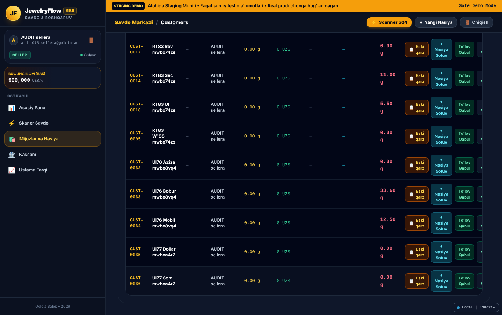
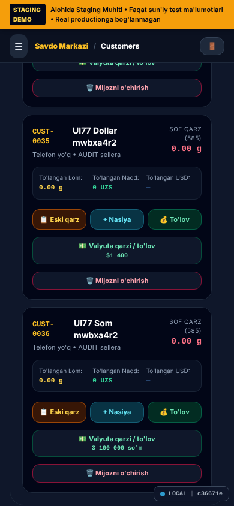
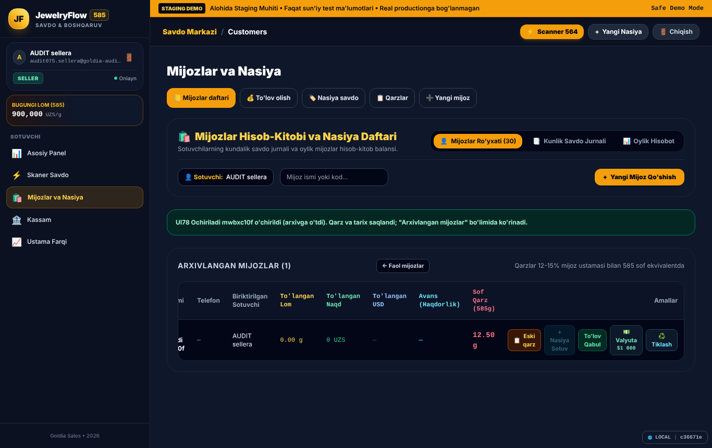

# Goldia Sales — 2-to'plam: Savdo va mijozlar qarzi
> Ushbu to'plam quyidagi fayllarni birlashtiradi: 03-sales.md, 04-customer-debts.md. Tekshirilgan kod: commit `052ad17`, schema `20260101000091`; production 088 (NOT VERIFIED). Sana: 2026-11-19. Barcha misollar sintetik.


---

<!-- manba fayl: 03-sales.md -->

## 03. Savdo (sotuv) jarayonlari

> **Tekshiruv pasporti:** commit `052ad17`, schema `20260101000091` (kod). Production: 088 (release hisobotlari bo'yicha, NOT VERIFIED). Sana: 2026-11-19. Misollar sintetik.

Goldia Sales'da savdoning **4 turi** bor. Hammasi sotuvchining omboridagi (unga tarqatilgan) tayyor 585 mahsulotdan chiqadi.

| # | Turi | Hujjat | RPC (eng so'nggi versiya) | Qarz birligi |
|---|---|---|---|---|
| 1 | Vazn bo'yicha (gramm + %) | `SALE-W-…` | `rpc_record_weight_sale` (076) | 585 g |
| 2 | Shtrix-kod / dona bo'yicha | `SALE-BC-…` | `rpc_record_barcode_piece_sale` (076) | 585 g |
| 3 | Aniq so'm yoki dollar narxda | `SALE-UZS-…`, `SALE-USD-…` | `rpc_record_currency_sale` (077) | UZS yoki USD |
| 4 | Butun partiyani nasiyaga (sotuvchi mobil "Nasiya") | `jewelry_sales` | `rpc_record_client_jewelry_sale` (076) | 585 g |

### 1. Vazn bo'yicha savdo (eng ko'p ishlatiladigan)

**Kim:** sotuvchi (o'z nomidan), menejer, direktor.
**Qayerda:** 🛍️ Mijozlar va Nasiya → mijoz qatorida **"+ Nasiya"** tugmasi → oynada narxlash: **"Gramm + %"**, rejim: **"⚖️ Vazn Bo'yicha (Gramm)"**. (Sotuvchi uchun "⚡ Skaner Savdo" sahifasida ham havola bor: "⚖️ Vazn bo'yicha savdo → Mijozlar".)

**Maydonlar** (`CustomerLedgerAndSheetsSection.tsx`):
- Sotuvchi omboridagi qoldiq (ko'rsatiladi, `get_seller_available_stock_grams`)
- Vazn (g) — majburiy
- "Avtomatik — eng eski donalardan ayriladi" yoki aniq dona tanlash (ixtiyoriy, 076)
- "Mijoz Ustama Foizi (%)" — standart qiymat 12.0 ("Standart: 12.0% yoki 15.0%. Asl bazaviy vazndan mustaqil hisoblanadi.")
- Izoh
- Tugma: **"Nasiyani Rasmiylashtirish"**

**UI tekshiruvlari:** foiz 0–100; vazn > 0; mijozga sotuvchi biriktirilgan bo'lishi ("Mijozga sotuvchi biriktirilmagan. Avval mijozni sotuvchiga biriktiring."); vazn ombordan oshsa tugma o'chadi.

**Server tekshiruvlari** (`rpc_record_weight_sale`):
1. `ERR_MARKUP_REQUIRED` — foiz yuborilmagan; `ERR_MARKUP_OUT_OF_RANGE` — 0..100 dan tashqari.
2. "Sotilayotgan mahsulot vazni 0 dan katta bo'lishi shart".
3. Sotuvchi boshqa sotuvchining mijoziga sota olmaydi (42501).
4. Sotuvchi bo'yicha qulf (`pg_advisory_xact_lock`) — bir vaqtda ikki savdo bir xil grammni ololmaydi.
5. `ERR_INSUFFICIENT_SELLER_STOCK` — sotuvchi omborida yetarli oltin yo'q.
6. Tanlangan donalar uchun: `ERR_PIECE_DUPLICATE`, `ERR_PIECE_NOT_AVAILABLE`, `ERR_PIECES_TOO_LIGHT`, `ERR_PIECE_EXTRA` ("faqat oxirgi dona qisman kesilishi mumkin").
7. Arxivlangan mijoz: `ERR_CUSTOMER_ARCHIVED` (trigger, 079).
8. Idempotentlik: bir xil kalit bilan qayta so'rov birinchi natijani qaytaradi.

**Formula:**
```
mijoz qarzi (client_gold_due) = vazn × (1 + mijoz% / 100)
avansdan ishlatiladi          = min(mijoz avansi, client_gold_due)
yangi qarz                    = client_gold_due − ishlatilgan avans
```
**Misol:** sotuvchida 50 g bor. Mijozga 10 g, 12% bilan: qarz = 10 × 1.12 = **11.2 g**. Mijozda 2 g avans bo'lsa: avans 2 g ishlatiladi, qarz +9.2 g, avans 0.

**Balanslarga ta'siri:**
| Hisob | O'zgarish |
|---|---|
| Sotuvchi ombori (fizik g) | −10 g (donalardan: butun donalar `sold`, oxirgisi kesiladi — `_goldia_consume_weight_sale_pieces`) |
| Mijoz 585 qarzi | +9.2 g (`current_debt_grams`), avans −2 g, `total_purchased_gold_grams` +11.2 |
| Sotuvchi majburiyati (Bozor qarzi) | **o'zgarmaydi** — majburiyat konsignatsiya paytida yaratilgan (085 hisobot: "savdo ombordan oladi, majburiyatni o'zgartirmaydi") |
| Sotuvchi kassasi | o'zgarmaydi (pul hali kelmagan) |
| Zavod hisobi | o'zgarmaydi |

Savdo yozuvida: `factory_markup_pct = 0`, `factory_gold_due_grams = vazn`, `markup_spread_grams = qarz − vazn` (vazn savdosida). Ustama farqi (`markup_difference_g`) trigger orqali yoziladi — `09-dashboard-reports.md`.

**Holat:** qarz ≤ 0.0001 bo'lsa `fully_paid`, aks holda `open_debt`.

### 2. Shtrix-kod (dona) bo'yicha savdo

**Kim:** sotuvchi (faqat o'z nomidan), menejer, direktor.
**Qayerda:** ⚡ Skaner Savdo → "Shtrix-kodli Savdo" (Scanner 564 yoki "Kamera Skaner"); yoki Mijozlar → "+ Nasiya" → "🏷️ Mahsulot Kodi Bo'yicha"; yoki vitrina ro'yxatida "⚡ Sotish".

**Jarayon (sotuvchi mobil):**
1. Model QR kodi va vazn shtrix-kodini skanerlash ("Vazn shtrixkodini skaner qiling (masalan: 14.52)...").
2. Tizim omboringizdan donani topadi: "✅ Omboringizdagi Mahsulot Topildi" (Proba, Aniq Vazn, Model).
3. "Xaridor Mijozni Tanlang *", mijoz foizi (presetlar tugmalari), izoh.
4. "⚡ Savdoni Tasdiqlash va Chek Berish".

**Server tekshiruvlari** (`rpc_record_barcode_piece_sale`): mijoz foizi majburiy (0–100); dona `held_by_seller` holatida, sotilmagan, aynan shu sotuvchiniki bo'lishi; aks holda: "Bu mahsulot donasi (...) allaqachon sotilgan", "Ruxsat etilmadi: Ushbu mahsulot donasi boshqa sotuvchiga biriktirilgan".

**Formula:**
```
zavod qismi (factory_due) = dona vazni × (1 + konsignatsiya zavod% / 100)
mijoz qarzi (client_due)  = dona vazni × (1 + mijoz% / 100)
spread                    = client_due − factory_due
```
**Misol:** dona 5 g, konsignatsiya zavod foizi 8%, mijoz foizi 15%: factory_due = 5.4 g; mijoz qarzi = **5.75 g**; spread = 0.35 g.

**Ta'sir:** dona `sold`; konsignatsiyada `sold_quantity +1` (qolgan donalar 0 bo'lsa `fully_sold`); mijoz qarzi +5.75 g (avans bo'lsa avval avans); sotuvchi majburiyati qayta hisoblanadi (`recalc_seller_gold_account`) — majburiyat o'zgarmaydi, ombor −5 g.

### 3. Aniq so'm / dollar narxdagi savdo (077)

**Qachon:** mahsulot grammda emas, kelishilgan narxda (masalan 2 000 $) sotilsa.
**Qayerda:** Mijozlar → "+ Nasiya" → narxlash **"Aniq UZS"** yoki **"Aniq USD"** (bu rejimda faqat vazn bo'yicha). Maydonlar: vazn (g), narx ("Masalan: 2000" / "Masalan: 25000000"), ixtiyoriy dona, izoh.

**Server** (`rpc_record_currency_sale`): valyuta faqat UZS/USD (`ERR_CURRENCY`); summa > 0 (`ERR_AMOUNT`); vazn > 0; ombor yetarli (`ERR_INSUFFICIENT_SELLER_STOCK`); sotuvchi faqat o'z omboridan; mijozga sotuvchi biriktirilgan bo'lishi kerak ("Sotuvchi aniqlanmadi (mijozga sotuvchi biriktiring yoki sotuvchini tanlang)").

**Ta'sir:**
| Hisob | O'zgarish |
|---|---|
| Sotuvchi ombori | −vazn |
| Mijozning shu valyutadagi qarzi (`client_currency_accounts`) | +summa (shu valyutada avans bo'lsa avval avans ishlatiladi) |
| Mijozning 585 qarzi | **o'zgarmaydi** |
| Sotuvchi majburiyati | o'zgarmaydi (konsignatsiyadan) |
| Savdo yozuvi | `sale_currency`, `sale_amount`, sotuvchining o'sha paytdagi USD va LOM kurslari snapshot (`sale_usd_rate_snapshot`, `sale_lom_rate_snapshot`) |

**Misol (testdan, `goldia-077-...test.ts`):** "$2000 sale of 20 g: stock -20 g, the 22 g obligation stays, customer owes 2000 USD, 585 debt untouched". Ya'ni sotuvchiga 20 g 10% bilan berilgan (majburiyat 22 g) — savdodan keyin ombor −20 g, majburiyat 22 g qoladi, mijoz 2000 $ qarz.

So'm/dollar qarz keyinchalik **CPAY** bilan to'lanadi (`05-payments-currency-lom.md`). Ustama farqi bu savdoda hisoblanmaydi (`markup_difference_g = NULL`).

### 4. Butun partiyani nasiyaga sotish (sotuvchi mobil "🏷️ Nasiya")

**Qayerda:** sotuvchi mobil ish joyi → "Mijozga Nasiyaga Mahsulot Sotish" ("Faqat direktor tasdiqlagan foizlar tanlanadi. Asl vazndan alohida hisoblanadi.") → "Topshiriladigan Mahsulot", "Mijoz", foiz, izoh → "Nasiyani Rasmiylashtirish & Chek".
**RPC:** `rpc_record_client_jewelry_sale`. Faqat **tegilmagan** partiya butunlay sotiladi; aks holda `ERR_CONSIGNMENT_PARTIALLY_USED` ("Partiya ... qisman sotilgan yoki qaytarilgan; donalab yoki vazn bo'yicha sotuvdan foydalaning").
Formula: `qarz = partiya bazaviy vazni × (1 + mijoz%)`; `spread = qarz − partiya factory_gold_due`.

### 5. Savdodan keyin chek

Har savdodan keyin `SalesReceiptModal` ochiladi: "📋 Nusxa olish", "🖨️ Chop etish", "Tayyor (Yopish)". Chekda: hujjat raqami, sotuvchi, mijoz (kod, telefon), mahsulot, bazaviy vazn, foizlar, qarz.

### 6. Savdoni bekor qilish, vozvrat va tahrirlash

Qisqacha (batafsil — `08-returns-reversals.md`):
- **"↩️ Bekor qilish"** (jurnalda) → `rpc_reverse_client_sale` — butun savdo storno; sabab majburiy.
- **"↩️ Vozvrat"** → `rpc_record_sale_return` (083) — qisman yoki to'liq qaytarish, asl savdo o'zgarmaydi.
- **"✏️ Tahrirlash"** → `rpc_edit_client_sale` (**090, deploy qilinmagan**) — eski savdo bekor + to'g'rilangan yangi savdo bitta tranzaksiyada.

### 7. Savdoga oid tez-tez uchraydigan xatolar

| Xabar | Sabab | Yechim |
|---|---|---|
| `ERR_INSUFFICIENT_SELLER_STOCK` | Sotuvchi omborida gramm yetmaydi | Menejer avval tovar tarqatsin (Scanner 564) |
| `ERR_MARKUP_REQUIRED` / `ERR_MARKUP_OUT_OF_RANGE` | Foiz yo'q yoki 0–100 dan tashqari | To'g'ri foiz kiriting |
| "Ushbu mijoz boshqa sotuvchiga biriktirilgan" | Sotuvchi begona mijozga sotmoqchi | Menejer savdo qiladi yoki mijozni qayta biriktiradi |
| `ERR_CUSTOMER_ARCHIVED` | Mijoz arxivda | Avval "♻️ Tiklash" |
| `ERR_PIECE_EXTRA` | Keraksiz qo'shimcha dona tanlangan | Faqat kerakli donalarni tanlang |
| `ERR_OPENING_DRAFT` | Boshlang'ich hisob qoralama holatida — oddiy yozuvlar qulflangan | Boshlang'ich hisob qulflanishini kuting |
| `ERR_FINANCIAL_FREEZE` | Backup/restart uchun moliyaviy yozuvlar to'xtatilgan (086) | Freeze tugashini kuting |

### 8. Skrinshotlar


*Izoh: lokal test (077), "Aniq USD" narxlash rejimi — vazn va dollar narxi kiritiladi, qarz dollarda yoziladi.*


*Izoh: telefon kengligida (390 px) UZS narxdagi savdo oynasi.*


---

<!-- manba fayl: 04-customer-debts.md -->

## 04. Mijozlar, nasiya (qarz) va avanslar

> **Tekshiruv pasporti:** commit `052ad17`, schema `20260101000091` (kod). Production: 088 (release hisobotlari bo'yicha, NOT VERIFIED). Sana: 2026-11-19. Misollar sintetik.

### 1. Mijoz balansi modeli

Har mijozning **uchta alohida hisobi** bo'lishi mumkin (`src/lib/customer-balance.ts`):

| Birlik | Jadval | Qarz ustuni | Avans ustuni |
|---|---|---|---|
| 585 gramm | `client_gold_accounts` | `current_debt_grams` | `advance_balance_grams` |
| UZS | `client_currency_accounts` (currency='UZS') | `debt_amount` | `advance_amount` |
| USD | `client_currency_accounts` (currency='USD') | `debt_amount` | `advance_amount` |

Formulalar (har birlik uchun alohida):
```
signedNet   = qarz − avans        (> 0: mijoz bizga qarzdor; < 0: biz mijozga qarzdormiz)
openDebt    = max(0,  signedNet)
openAdvance = max(0, −signedNet)
Jami: grossDebt = Σ openDebt;  grossAdvance = Σ openAdvance;  signedNet = grossDebt − grossAdvance
```
Manfiy jami **"Biz mijozlarga qarzdormiz"** deb ko'rsatiladi, 0 ga qirqilmaydi. **Mijoz avansi sotuvchi majburiyatini o'zgartirmaydi** (customer-balance.ts izohi).

**Misol:** A mijoz: qarz 12 g, avans 0 → +12. B mijoz: qarz 0, avans 3 g → −3. Jami: grossDebt 12, grossAdvance 3, signedNet **+9 g** ("qarz 12 g − avans 3 g"). UZS va USD alohida qatorlarda.

### 2. Avans qanday paydo bo'ladi va qanday ishlatiladi

Avans paydo bo'ladi:
1. To'lov qarzdan ko'p bo'lsa — ortig'i avans (`rpc_record_client_settlement`: "Ortiqcha to'lov (Avans balansi)").
2. Savdo bekor qilinganda mijoz allaqachon to'lagan qism avansga o'tadi (`rpc_reverse_client_sale`, 070 izohi).
3. Vozvrat qiymati ochiq qarzdan oshsa — ortig'i avans, naqd qaytarilmaydi (083).
4. Eski avans kiritilsa (`rpc_record_client_legacy_debt`, balans turi "advance").
5. Boshlang'ich hisobda mijoz avansi (E/F hujjatlar, 085).

Avans ishlatiladi: keyingi savdoda avtomatik — `min(avans, yangi qarz)` (vazn, dona, partiya savdolarida 585 avans; valyuta savdosida shu valyutadagi avans).

### 3. Mijozlar va Nasiya sahifasi (`/sales/app/customers`)

**Komponent:** `CustomerLedgerAndSheetsSection.tsx`. Sarlavha: *"Mijozlar Hisob-Kitobi va Nasiya Daftari"*.

Uch ichki tab:
1. **👤 Mijozlar Ro'yxati (N)** — jadval ustunlari: Kod, Mijoz Ismi, Telefon, Biriktirilgan Sotuvchi, To'langan Lom, To'langan Naqd, To'langan USD, Avans (Haqdorlik), Sof Qarz (585g), Amallar. Yuqorida: "👤 Sotuvchi:" filtri ("Barcha Sotuvchilar (Bozor)"), qidiruv ("Mijoz ismi yoki kod..."), **"+ Yangi Mijoz Qo'shish"**, "🗄️ Arxivlangan mijozlar (N)".
2. **📑 Kunlik Savdo Jurnali** — ustunlar: Sana, Hujjat turi, Klient Ism, Mahsulot / Izoh, Sotilgan gr, Ustama %, gram+%, Lom berdi, Pul berdi (UZS), Lom narxi, Pul+Lom (eq), Qarzdorlik, Amallar. Sana filtri, "Bugun"/"Kecha" tugmalari, CSV.
3. **📊 Oylik Hisobot** — ustunlar: Mijoz Ismi, Kod, Boshlang'ich / Eski Qarz, Oy Davomida Sotuv, Lom Tushumi, Pul Tushumi (UZS), Pul Eq (g), USD Tushumi ($), USD Kursi, USD Eq (g), Jami Yopilgan, Yakuniy Qarz. Pastda: Jami Tarqatilgan (Oyda), Jami Yig'ilgan (Oyda), Mijozlar sof qoldig'i (585), Sotuvchi G'aznasi, Boshqaruvchiga Bozor Qarzi. RPC: `rpc_get_customer_monthly_report` (083).

**Mijoz qatoridagi tugmalar:**
| Tugma | Vazifa | Kim | RPC |
|---|---|---|---|
| 📋 Eski qarz | Eski qarz/avans kiritish yoki qayta solishtirish | hamma (sotuvchi cheklangan) | `rpc_record_client_legacy_debt` |
| ↩️ Eski savdo vozvrati (T0 dan oldingi tovar) | **089, deploy qilinmagan** | management | `rpc_record_opening_sale_return` |
| + Nasiya | Savdo | hamma | `03-sales.md` |
| 💰 To'lov | 585 qarzga to'lov (SETTL) | hamma | `rpc_record_client_settlement` |
| 💵 Valyuta qarzi / to'lov | So'm/USD qarzga to'lov (CPAY) | hamma | `rpc_record_client_currency_settlement` |
| 🗑️ Mijozni o'chirish / ♻️ Tiklash | Arxivlash (soft delete) | sotuvchi o'z mijozini, management hammani | `rpc_archive_customer` |

Jurnal qatoridagi tugmalar: **↩️ Vozvrat** (savdo), **💱 Valyutani tuzatish** (to'lov, management, *089*), **✏️ Tahrirlash** (savdo, *090*), **↩️ Bekor qilish**; tasdiqlangan qatorlarda "🔒 Tasdiqlangan".

### 4. Yangi mijoz

**Maydonlar** (management oynasi): "Mijoz To'liq Ismi *", "Telefon raqami", "Biriktirilgan Sotuvchi", "Izoh / Manzil" → **"Mijozni Saqlash"**.
Sotuvchi mobil: "Ism Familiya (F.I.O)", "Telefon Raqami", "Kompaniya / Pasport yoki PINFL" → "Mijozni Saqlash (ID Yaratish)".
**RPC:** `rpc_create_customer_with_code` (075). Kod tashkilot ichida raqamlanadi (`CUST-0001`...), bir tashkilotda bir xil ism qayta kiritilsa mavjud mijoz qaytariladi (test 075). Sotuvchi mijozni faqat o'ziga biriktiradi. To'g'ridan-to'g'ri INSERT barcha rollar uchun rad etiladi (`_goldia_guard_customer_code`).

### 5. Mijozni arxivlash (o'chirish) — 078/079

- Tugma: "🗑️ Mijozni o'chirish" (arxivda: "♻️ Tiklash").
- **Ochiq qarz saqlanadi**, tarix saqlanadi, qarz hisobotda qoladi va undiriladi (test 078 SEC-3).
- Arxivlangan mijozga yangi savdo qilib bo'lmaydi: *"ERR_CUSTOMER_ARCHIVED: Mijoz arxivlangan (o'chirilgan) - unga yangi savdo qilib bo'lmaydi. Eski qarz to'lovini qabul qilish mumkin; savdo uchun avval mijozni tiklang."*
- Sotuvchi faqat o'z mijozini arxivlaydi/tiklaydi; boshqa holat: "Ruxsat etilmadi: mijozni faqat uning sotuvchisi, menejer yoki direktor arxivlay oladi".
- Qayta bosish hech narsani o'zgartirmaydi (`changed: false`).


*Izoh: lokal test (078) — sotuvchining arxivlangan mijozlar ro'yxati.*

### 6. Eski qarz (legacy debt) — daftardagi qoldiqni kiritish

**Oyna:** "Mijoz Eski Qarzini Kiritish / Qayta Solishtirish". Maydonlar: "Hisoblash usuli" (qayta solishtirish yoki to'g'ridan-to'g'ri), "Balans turi" (Qarz / Avans), miqdor (585 g), "Qaysi sanadagi holat *", "Daftar raqami / Izoh *". Ko'rsatiladi: "Tizimdagi joriy holat", "Daftardagi maqsad", "Kiritiladigan farq (Δ)", "Hosil bo'ladigan yangi qoldiq".

**RPC:** `rpc_record_client_legacy_debt` (081). Yozuv turlari: `initial`, `manual_addition`, `reconciliation_adjustment`, `reversal`, `opening` (085 cheklovi).

**Qayta solishtirish formulasi** (`p_target_final_balance` berilganda):
```
qarz maqsadi:  Δ = maqsad − (joriy qarz − joriy avans)
avans maqsadi: Δ = (−maqsad) − (joriy qarz − joriy avans)
```
**Misol:** mijozda tizimda qarz 8 g, avans 0. Daftarda 10 g bo'lishi kerak → Δ = +2 g, yangi qarz 10 g.

**Qoidalar:**
- Sotuvchi: faqat o'z mijoziga, faqat **qarz qo'shish** (076). Kamaytirish: *"Ruxsat etilmadi: Qarzni kamaytirishni faqat menejer yoki direktor bajaradi"*.
- Sotuvchi avansi (081): faqat qarzi yo'q mijozga va faqat qo'shish sifatida. Qarzi bor mijozga: *"Ruxsat etilmadi: Mijozda ochiq qarz bor (% g) - avans uni kamaytiradi; buni faqat menejer yoki direktor bajaradi"*.
- Bir xil qo'shimcha 10 daqiqa ichida qayta yuborilsa rad: *"Takroriy so'rov: shu mijozga xuddi shu eski qarz (% g) 10 daqiqa ichida kiritilgan."*
- **Sotuvchi majburiyatiga ta'siri:** `balance_type='debt'` bo'lgan eski qarz yozuvlari sotuvchi majburiyatiga qo'shiladi: `seller_legacy_debt_obligation_g = max(0, Σ delta_585_g)` (`recalc_seller_gold_account`). Misol: sotuvchi o'z mijoziga 20 g eski qarz kiritsa, majburiyati ham +20 g (test 076: "his obligation grows 1:1").
- Bekor qilish: faqat management (`rpc_reverse_client_legacy_debt`), sabab majburiy; keyingi qayta solishtirish yozuvi bo'lsa avval o'sha bekor qilinadi.

### 7. Boshlang'ich (T0) qarzlar — E va F hujjatlar (085/088)

- **E** — mijozning 585 g qarzi/avansi; eski qarz yozuvi (`opening` turi) sifatida, sotuvchi majburiyatini 076 qoidasi bo'yicha yaratadi.
- **F** — mijozning so'm/USD qarzi/avansi. Asl valyuta va summa saqlanadi. Kurs berilsa sotuvchi majburiyati **bir marta** yaratiladi: `8 600 000 / 860 000 = 10 g` (USD: summa × USD kursi / 585 kursi). 088'dan kurs ixtiyoriy: kurssiz F "Hali hisoblanmagan" — keyingi har bir to'lov faqat o'sha to'lov kursida va faqat boshlang'ich qarzga tushgan qismini baholaydi.

Batafsil: `05-payments-currency-lom.md` §5 va `07-factory-manager-accounting.md` §7.

### 8. Mijozning birlashtirilgan hisobi

`rpc_get_unified_customer_ledger` (089 versiyasi): har mijoz bo'yicha 585 qarz/avans, valyuta (UZS/USD qarz, avans, CPAY to'langan/soni/bekor qilingan) va `old_sale_return_g`. Production 088'da bu RPC'ning oldingi versiyasi ishlaydi (089 qo'shimchalarisiz).

### 9. Mijoz bo'yicha tez-tez beriladigan savollar

- *"Mijoz qarzi nega manfiy?"* — manfiy = avans: biz mijozga qarzdormiz.
- *"Mijoz o'chirilsa qarz yo'qoladimi?"* — Yo'q, arxivda qarz saqlanadi va to'lov qabul qilinadi.
- *"Sotuvchi mijozni boshqa sotuvchiga o'tkaza oladimi?"* — Yo'q, faqat direktor/menejer (079).
