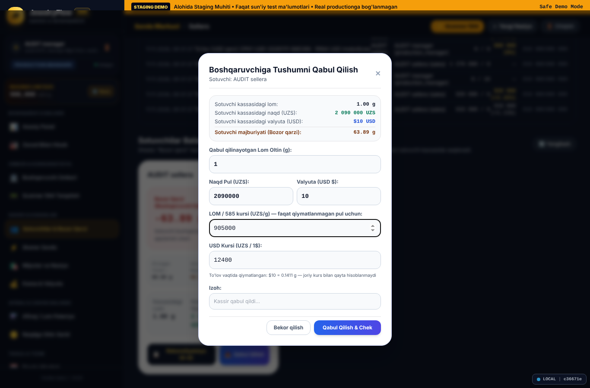
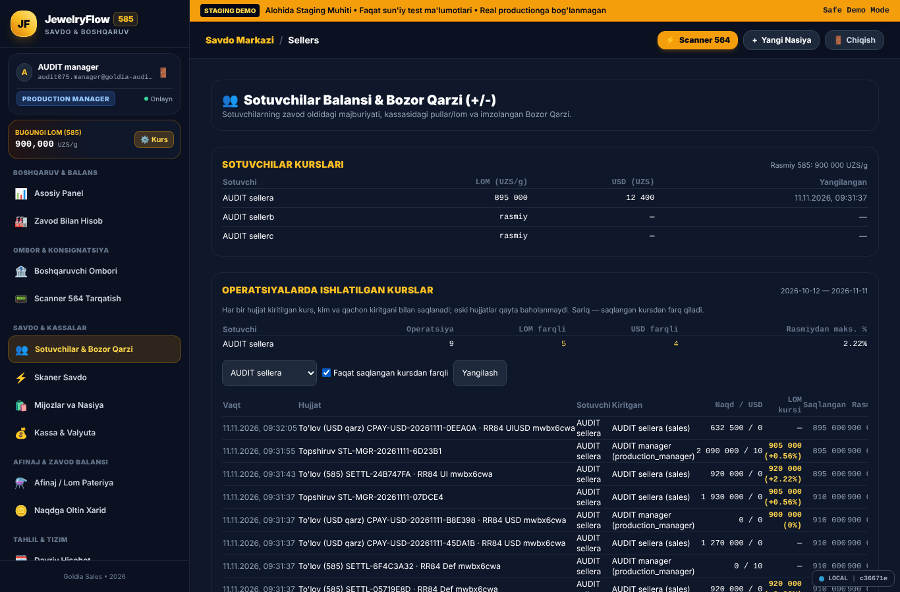
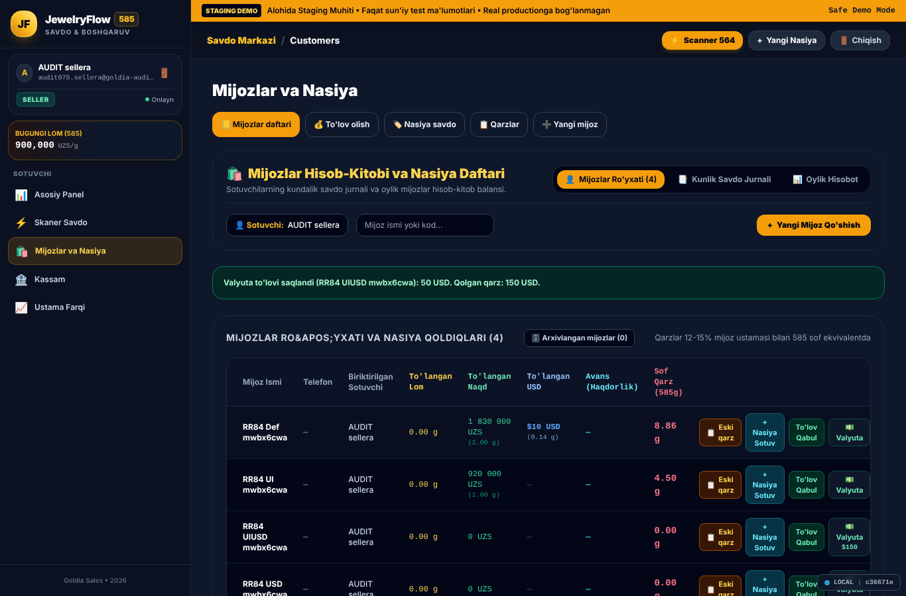

# Goldia Sales — 3-to'plam: To'lovlar, valyuta, LOM, 585 proba, kurslar
> Ushbu to'plam quyidagi fayllarni birlashtiradi: 05-payments-currency-lom.md. Tekshirilgan kod: commit `052ad17`, schema `20260101000091`; production 088 (NOT VERIFIED). Sana: 2026-11-19. Barcha misollar sintetik.


---

<!-- manba fayl: 05-payments-currency-lom.md -->

## 05. To'lovlar, valyuta (UZS/USD), LOM, 585 proba va kurslar

> **Tekshiruv pasporti:** commit `052ad17`, schema `20260101000091` (kod). Production: 088 (release hisobotlari bo'yicha, NOT VERIFIED). Sana: 2026-11-19. Misollar sintetik.

### 1. Asosiy tushunchalar

| Atama | Ma'nosi | Formula / manba |
|---|---|---|
| **585 proba** | 1000 qismdan 585 qismi sof oltin bo'lgan qotishma. Goldia Sales'ning asosiy hisob birligi. | — |
| **Fizik vazn** | Tarozida ko'rsatilgan haqiqiy gramm (`physical_scrap_grams`, `seller_till_scrap_physical_g`) | — |
| **Sof oltin (fine)** | Fizik vazn ichidagi toza oltin | `fine = fizik × proba / 1000` |
| **585 ekvivalenti** | Shu oltin necha gramm 585 ga teng | `585eq = fizik × proba / 585` |
| **LOM** | Mijoz to'lov sifatida beradigan yoki bozordan olinadigan eski/singan oltin (skrap) | proba 300–1000 (`rpc_record_client_settlement`) |
| **LOM (585) kursi** | 1 g 585 oltin necha so'm | `daily_gold_rates` (proba 585) yoki operatsiyada kiritilgan kurs |
| **USD kursi** | 1 $ necha so'm | operatsiyada kiritiladi (084'dan beri "taxminiy" standart kurs yo'q) |

**Misol (proba):** mijoz 10 g 750 proba lom berdi. Sof oltin = 10 × 0.750 = **7.5 g**; 585 ekvivalenti = 10 × 750 / 585 = **12.8205 g**. Mijozning 585 qarzidan 12.8205 g yopiladi.

### 2. Ikki xil to'lov: SETTL va CPAY

| | **SETTL** — 585 gramm qarzga | **CPAY** — so'm/dollar qarzga |
|---|---|---|
| UI matni | "Bu to'lov mijozning 585 GRAMM qarzini yopadi (SETTL)..." (`payment-hints.ts`) | "💵 Valyuta qarzi / to'lov" oynasi |
| RPC | `rpc_record_client_settlement` (084) | `rpc_record_client_currency_settlement` (089; prod'da 088 versiyasi) |
| Hujjat | `SETTL-XXXXXXXX` | `CPAY-UZS-YYYYMMDD-XXXXXX` / `CPAY-USD-...` |
| Jadval | `gold_settlements` (direction `client_to_seller`) | `client_currency_settlements` |
| To'lov vositalari | lom (g + proba), naqd so'm, naqd dollar | naqd so'm, naqd dollar, lom |
| Kurs | Pul → gramm: LOM kursi (+ USD kursi) | Qarz valyutasiga aylantirish: USD kursi, LOM kursi |
| Sotuvchi kassasiga | lom (fizik + 585eq), so'm, dollar | xuddi shunday (bir marta) |

UI ogohlantiruvi: so'm summasi butun dollarga to'g'ri kelsa — "Mijoz bergan DOLLAR (USD) — so'mga aylantirmang" va maxsus ogohlantirish (`wholeDollarsWarning`, P1 UI `3d87193`).

### 3. SETTL — 585 qarzga to'lov

**Qayerda:** Mijozlar → **"💰 To'lov"** (yoki sotuvchi: "💰 To'lov olish" tabi, mobil: "Mijozdan To'lov (Lom yoki Pul) Qabul Qilish").
**Maydonlar:** "Qaytarilgan Lom (g)", "Lom Probasi" (585 / 375 / 750 / 995 / 999.9), "Mijoz bergan SO'M (UZS)", "Mijoz bergan DOLLAR (USD) — so'mga aylantirmang", LOM kursi (sotuvchi uchun: "Sizning saqlangan kursingiz (Kassam)"), USD kursi (MB — Markaziy bank kursi tugmasi), Izoh. Ko'rsatiladi: "Jami hisobdan o'chiriladigan", "Qoladigan qarz", "Ortiqcha to'lov (Avans balansi)". Tugma: **"To'lovni Tasdiqlash"**.

**Server qoidalari:**
1. Kamida bittasi > 0: lom, so'm yoki dollar.
2. Lom bo'lsa proba majburiy, 300–1000.
3. Naqd/dollar bo'lsa LOM kursi kerak: sotuvchi uchun standart — **o'zining saqlangan kursi** (yo'q bo'lsa rasmiy), menejer/direktor uchun — rasmiy kurs; har qanday rol operatsiyada boshqa kurs kirita oladi (084, `_goldia_operation_rate`). Kurs yo'q: `ERR_DAILY_RATE_NOT_SET`.
4. Dollar bo'lsa USD kursi kerak: `ERR_RATE_REQUIRED: Dollar (USD) to'lovi uchun USD kursini kiriting` ("NO SILENT 12,850 FALLBACK").
5. Kurs chegaralari (`_goldia_seller_rate_limits`, standart): LOM 100 000 – 3 000 000 so'm/g; USD 5 000 – 30 000 so'm; sotuvchining LOM kursi rasmiydan **25%** dan ortiq farq qilmasin (`ERR_RATE_OUT_OF_RANGE`).
6. Sotuvchi faqat o'z kassasiga va o'z (yoki biriktirilmagan) mijoziga.

**Formulalar:**
```
lom_585eq   = lom_fizik × proba / 585
naqd_g      = so'm / LOM_kursi
dollar_g    = (dollar × USD_kursi) / LOM_kursi
jami_to'lov = lom_585eq + naqd_g + dollar_g
agar jami ≤ qarz:  qarz −= jami
aks holda:          qarz = 0;  avans += (jami − qarz)
```

**Sonli misol:** mijoz qarzi 10 g. LOM kursi 900 000, USD kursi 12 600. Mijoz beradi: 2 g 750 lom + 1 800 000 so'm + 100 $.
- lom_585eq = 2 × 750/585 = 2.5641 g
- naqd_g = 1 800 000 / 900 000 = 2.0000 g
- dollar_g = 100 × 12 600 / 900 000 = 1.4000 g
- jami = **5.9641 g** → qoladigan qarz = 10 − 5.9641 = **4.0359 g**, avans 0.

**Balanslarga ta'siri:**
| Hisob | O'zgarish |
|---|---|
| Mijoz 585 qarzi | −5.9641 g (yoki 0 + avans) |
| Sotuvchi kassasi — lom | fizik +2 g; 585eq +2.5641 g |
| Sotuvchi kassasi — so'm | +1 800 000 |
| Sotuvchi kassasi — dollar | +100 |
| Sotuvchining "qiymatlangan pul havzasi" (072) | so'm 1 800 000 ↔ 2.0 g; dollar 100 ↔ 1.4 g (to'lov paytidagi gramm saqlanadi) |
| Sotuvchi majburiyati | **o'zgarmaydi** (faqat topshiruvda kamayadi) |

### 4. CPAY — so'm/dollar qarzga to'lov

**Qayerda:** Mijozlar → **"💵 Valyuta qarzi / to'lov"** (`CurrencyPaymentModal.tsx`). Tab: UZS qarzi / USD qarzi. Maydonlar: "Mijoz bergan SO'M", "Mijoz bergan DOLLAR (USD) — so'mga aylantirmang", "Lom (fizik g)", "Proba", "USD kursi (so'm)", "LOM 585 kursi (so'm/g)". Ko'rsatiladi: "Qarzga yoziladi:". Tugma: **"To'lovni saqlash"**; tarixda "↩️" (bekor qilish).

**Kredit summasi (qarz valyutasida):**
```
UZS qarz:  kredit = so'm + dollar × USD_kursi + lom_585eq × LOM_kursi
USD qarz:  kredit = dollar + (so'm + lom_585eq × LOM_kursi) / USD_kursi
qarz/avans: yangi_net = (qarz − avans) − kredit;  qarz = max(net,0);  avans = max(−net,0)
```
USD kursi kerak bo'ladi: USD qarzni so'm yoki lom bilan yopishda, yoki UZS qarzni dollar bilan yopishda.

**Misol 1 (UZS qarz):** qarz 5 000 000 so'm. Mijoz 100 $ beradi, USD kursi 12 600 → kredit 1 260 000; qoladigan qarz **3 740 000 so'm**. Sotuvchi kassasiga +100 $ (so'm emas!).
**Misol 2 (USD qarz):** qarz 300 $. Mijoz 1 260 000 so'm beradi, kurs 12 600 → kredit **100 $**; qarz 200 $. Kassaga +1 260 000 so'm.
**Misol 3 (lom bilan USD qarz):** 2 g 585 lom, LOM kursi 900 000, USD 12 600 → 1 800 000 / 12 600 = **142.86 $** kredit.

**Muhim:** oddiy valyuta savdosining qarziga tushgan pul **qiymatlanmagan** (gramm biriktirilmagan) — sotuvchi menejerga topshirganda topshiruv kursida grammga aylantiriladi. CPAY yangi sotuvchi majburiyatini yaratmaydi (085 hisobot: "valyuta to'lovi yangi sotuvchi majburiyatini yaratmaydi").

#### 4.1 CPAY va boshlang'ich (F) qarz (085/088)
- Agar mijozda faol boshlang'ich so'm/USD qarz (F hujjat) bo'lsa, to'lovning **faqat F qarzning qolgan qismiga** tushgan qismi alohida hisoblanadi.
- **Kursli F:** to'langan qism F hujjatining 585 g snapshotidan proportsional ulushni olib, qiymatlangan havzaga kiritadi (to'liq yopilsa — qolgan barcha grammlar, yaxlitlash qoldig'isiz).
- **Kurssiz F (088):** to'langan qism **shu to'lov kurslari** bilan baholanadi: `g = (UZS: summa | USD: summa × USD_kursi) / LOM_kursi` va shu payt sotuvchi majburiyatiga qo'shiladi (`unrated_opening_debt_valued_g`); kurs kiritilmasa: `ERR_RATE_REQUIRED`.
- Avans qismi havzaga **0 g** bilan kiradi (avansni topshirish majburiyatni kamaytirmaydi, D-3).
- F qarz boshqa sotuvchining majburiyatida bo'lsa: `ERR_OPENING_DEBT_OTHER_SELLER` — to'lov o'sha sotuvchining kassasiga qabul qilinadi.

**Misol (test D-2, 085):** F qarz 8 600 000 so'm @ 860 000 = 10 g. To'liq to'landi va 900 000 kursida topshirildi → sotuvchi majburiyati aniq −10 g, kompaniya kurs farqi **0.4444 g** (10 − 8 600 000/900 000), mijoz qarzi 0.

### 5. Sotuvchidan menejerga kassa topshiruvi ("Boshqaruvchiga Tushumni Qabul Qilish")

**Kim yozadi:** menejer/direktor (UI). Kassam sahifasida sotuvchiga: *"Topshirishni boshqaruvchi qabul qilib yozadi. Yozilgan topshirish sizning bozor qarzingizni yopadi."*
**Qayerda:** 👥 Sotuvchilar & Bozor Qarzi → sotuvchi kartasida qabul tugmasi → oyna: "Sotuvchi kassasidagi lom:", "Sotuvchi kassasidagi naqd (UZS):", "Sotuvchi kassasidagi valyuta (USD):", "Sotuvchi majburiyati (Bozor qarzi):"; maydonlar "Qabul qilinayotgan Lom Oltin (g)", "Naqd Pul (UZS)", "Valyuta (USD $)", **"LOM / 585 kursi (UZS/g) — faqat qiymatlanmagan pul uchun:"**, "USD Kursi (UZS / 1$)", "Izoh" → **"Qabul Qilish & Chek"**.
**RPC:** `rpc_record_seller_to_manager_settlement` (085) → hujjat `STL-MGR-...`.

**Server qoidalari:** kassadagidan ko'p berib bo'lmaydi: `ERR_INSUFFICIENT_SCRAP_BALANCE`, `ERR_INSUFFICIENT_CASH_BALANCE`, `ERR_INSUFFICIENT_USD_BALANCE`. Qulf tartibi: avval menejer seyfi, keyin sotuvchi hisobi.

**Hisob (072 + 085):**
```
qiymatlangan_qism  = min(topshirilgan pul, havzadagi pul)
qiymatlangan_g     = havza_grammi × qiymatlangan_qism / havza_puli     (to'lov paytidagi gramm)
qiymatlanmagan_qism = topshirilgan − qiymatlangan_qism  → topshiruv kursida: so'm / LOM_kursi; dollar × USD_kursi / LOM_kursi
jami_yopilgan_g    = lom_585eq + naqd_g + dollar_g
kompaniya_kurs_farqi_g = qiymatlangan_g − qiymatlangan_pul / farq_kursi   (farq_kursi = kiritilgan LOM kursi, aks holda rasmiy)
```
**Misol:** sotuvchi SETTL bilan 1 800 000 so'm oldi (900 000 kursda = 2 g, havzada). Topshiruv kuni kurs 950 000. Topshiruv: 1 800 000 so'm.
- Yopiladi **2.0000 g** (havzadagi gramm), 1 894 737 emas.
- Kompaniya kurs farqi = 2 − 1 800 000/950 000 = 2 − 1.8947 = **0.1053 g** (kompaniya hisobiga; sotuvchiga yuklanmaydi).
Agar yana 950 000 so'm qiymatlanmagan pul (valyuta savdosidan) bo'lsa: 950 000 / 950 000 = +1 g.

**Ta'sir:** sotuvchi kassasi −(lom, so'm, $); menejer seyfi +(lom fizik va 585eq, so'm, $); sotuvchi majburiyati −jami_yopilgan_g (`recalc_seller_gold_account`: topshiruvlar yig'indisi majburiyatdan ayiriladi); oshib ketsa "menejer sotuvchiga qarzdor" (Bozor qarzi musbat).


*Izoh: lokal test (084/085). "To'lov vaqtida qiymatlangan: $10 = 0.1411 g — joriy kurs bilan qayta hisoblanmaydi" yozuviga e'tibor bering.*

### 6. Kurslar

#### 6.1 Kunlik rasmiy LOM kursi
- Chap menyudagi "Bugungi Lom (585)" kartasi → **"⚙️ Kurs"** (faqat management) → "Saqlash". RPC: `rpc_set_daily_gold_rate` (073): proba 585, sana = Toshkent sanasi. *"The audited RPC is the only write path for rates"* (layout.tsx).
- Rasmiy kurs = eng so'nggi **tasdiqlangan** 585 kurs, bo'lmasa eng so'nggi kurs (`_goldia_official_585_rate`).
- Kurs bo'lmasa kartada: "Kurs belgilanmagan".

#### 6.2 Sotuvchining o'z kurslari (072)
- Kassam → **"Mening kurslarim"**: LOM (UZS/g), USD (UZS), "Yangi LOM kursi", "Yangi USD kursi", "Izoh (ixtiyoriy)" → "Kursni saqlash". RPC `rpc_set_my_seller_rates` — faqat sotuvchi o'zi uchun.
- Menejer: Sotuvchilar sahifasida "Sotuvchilar kurslari" bo'limi (faqat ko'rish) va "Operatsiya kurslari tekshiruvi" (`OperationRateReview`, `rpc_get_operation_rate_review`): "Faqat saqlangan kursdan farqli" filtri.

#### 6.3 Operatsiya kursi (084)
Har to'lov/topshiruvda kurs **kiritiladi va snapshot qilinadi**. Standart: sotuvchi — o'z saqlangan kursi; management — rasmiy kurs (USD uchun standart yo'q). Kurs keyinchalik o'zgarsa eski hujjatlar **qayta hisoblanmaydi**.


*Izoh: lokal test (084) — sotuvchilar ishlatgan LOM/USD kurslari saqlangan va rasmiy kurs bilan solishtiriladi.*

### 7. Sotuvchining bozordan LOM xaridi — **091, DEPLOY QILINMAGAN**

**Qayerda:** Kassam (sotuvchi, o'z kassasi) va Kassa & Valyuta (menejer sotuvchini tanlaydi) → **"🪙 Bozordan LOM xarid qilish"**: Sotuvchi, Fizik gramm, Proba, Jami UZS **yoki** 1 g narxi (UZS), Kimdan (ixtiyoriy), Izoh → "Lom xaridini saqlash"; tarixda "Bekor qilish".
**RPC:** `rpc_record_seller_lom_purchase` / `rpc_reverse_seller_lom_purchase`.
**Formula:** `kassa so'm −= summa; kassa lom fizik += g; kassa lom 585eq += g × proba / 585`. Mijoz qarzi, sotuvchi majburiyati, zavod, foyda — o'zgarmaydi.
**Misol:** 2 g 750 lomni 1 800 000 so'mga oldi: so'm −1 800 000; lom fizik +2 g; 585eq +2.5641 g.
**Rad etiladi:** kassadagidan ko'p so'm (`ERR_INSUFFICIENT_CASH_BALANCE`), boshqa sotuvchi kassasi (`ERR_NOT_OWN_TILL`), proba 300–1000 dan tashqari (`ERR_PROBA`), jami va 1 g narxi mos emas (`ERR_PRICE_MISMATCH`), kelajak sana (`ERR_FUTURE_DATE`), yopilgan davr, T0 dan oldin, draft/freeze. Bekor qilish faqat lom hali kassada bo'lsa (`ERR_LOM_ALREADY_USED`).

### 8. Kassa sanog'i — **089, DEPLOY QILINMAGAN**

Sotuvchi kartasida **"🧮 Kassa sanog'i"** (`SellerTillCountModal`): "Topshirilishi kerak: ... Bu faqat qayd: kassa va majburiyat o'zgarmaydi, yangi qarz yaratilmaydi." Maydonlar: "Sotuvchida haqiqatda bor SO'M", "... DOLLAR"; kam bo'lsa sabab: **"Shaxsiy ishlatilgan"** yoki **"Yetishmovchilik"** (`ERR_EXPLANATION_REQUIRED`). "Oxirgi sanoqlar" ro'yxati. RPC: `rpc_record_seller_till_count` (faqat management).

### 9. To'lov valyutasini tuzatish — **089, DEPLOY QILINMAGAN**

Jurnaldagi SETTL/CPAY qatorida **"💱 Valyutani tuzatish"** (`PaymentCorrectionModal`): "💱 To'lov valyutasini tuzatish ... bitta amalda". Tanlov: "585 gramm qarzi (SETTL)" / "So'm / dollar qarzi (CPAY)", "Qaysi qarz yopiladi" (UZS/USD), summalar, kurslar, "Sabab". RPC: `rpc_correct_client_payment` — eski to'lov o'z bekor qilish funksiyasi bilan bekor qilinadi va yangisi mavjud SETTL/CPAY funksiyasi bilan yoziladi; biror qadam xato bo'lsa hech narsa yozilmaydi. Butun dollar so'm summasi dollar maydoniga ko'chirib tekshirish uchun taklif qilinadi.

### 10. To'lovni bekor qilish

| To'lov | RPC | Kim | Shart |
|---|---|---|---|
| SETTL | `rpc_reverse_client_settlement` (065) | management | Sotuvchi kassasida o'sha lom/so'm/dollar hali bo'lishi: aks holda "To'lovni bekor qilib bo'lmaydi: Sotuvchi kassasidagi ... yetarli emas. Avval boshqaruvchiga topshirilgan lomni qaytaring." |
| CPAY | `rpc_reverse_client_currency_settlement` (088) | management | Sabab majburiy; to'lovdan keyin topshiruv bo'lgan bo'lsa: `ERR_TILL_ALREADY_HANDED_OVER` — avval topshiruvni bekor qiling |
| Topshiruv | `rpc_reverse_seller_to_manager_settlement` (073) | management | Menejer seyfida o'sha lom/pul hali bo'lishi (afinaj yoki zavodga yuborilmagan) |

Batafsil ta'sirlar: `08-returns-reversals.md`.


*Izoh: lokal test — "Valyuta to'lovi saqlandi (...): 50 USD. Qolgan qarz: 150 USD." xabari; mijoz ro'yxatida To'langan Naqd / To'langan USD ustunlari.*
